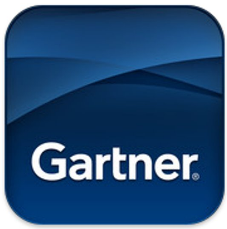

<!-- Slide 1 -->

# Module 1 - Introduction to DevOps

---

<!-- Slide 2 -->

# Brief History of Software Development Industry (Birth view)

-   1969: C programming language and UNIX portable OS
-   1971: Floppy disk
-   1973: Ethernet
-   1976: Apple I
-   1981: IBM Personal Computer with MS-DOS
-   1983: Apple’s Lisa GUI
-   1984: X Windows System

-   1985: Microsoft Windows 1
-   1989: World Wide Web
-   1991: Linux
-   1992: CD-ROM in PC
-   1995: Windows 95
-   1995: Netscape Navigator
-   1996: DVD-ROM in PC

-   1999: Wi-Fi in PC
-   2006: Amazon Web Services
-   2007: iPhone 1
-   2008: Android
-   2010: Azure
-   2012: Google Cloud
-   2017: Facebook 2 billion users

---

<!-- Slide 3 -->

# Personal Computers

-   Box Software era
    -   1970-1980 - Software was distributed primary on floppy diskettes
    -   1990-2000 - Software was distributed primary on compact disks
    -   2000-2010 - Software was distributed primary on CD and DVD
-   Internet Software era
    -   2010-Nowadays - Software is distributed primary thought internet

---

<!-- Slide 4 -->

# Web Applications

-   Application software that is served by a web server
-   End-User access the web application through a web browser
-   Active network connection

---

<!-- Slide 5 -->

# Web 1.0

-   Rise of the Internet
    -   The mid-1990s - the widespread adoption of the World Wide Web.
-   The first web sites
-   Berners-Lee – “The read only web”
-   Static content
-   Searchable information
-   First search engines (scrape bots)

---

<!-- Slide 6 -->

# Web 2.0

-   Berners-Lee – “The read-write web”
-   Dramatically changed the landscape of the web
-   Dynamic content generation
-   Contribute content
-   Interact and collaborate with other users
-   Web Applications

---

<!-- Slide 7 -->

# Mobile applications

-   Mobile Devices (computers)
    
-   Mobile Operating Systems
    
    -   Operating system for mobile devices
    -   Combine features of a desktop OS with other features useful for handheld use
    -   Two main competitors
        -   Android - 2.7 million apps
        -   IOS - 1.82 million apps
-   Traditional desktop OS is now a minority-used kind of OS
    
-   In 2019, over 1.5 billion mobile phones were sold
    
-   In 2019, over 261.24 million PCs and laptops were sold

---

<!-- Slide 8 -->

# Software in the Cloud

Cloud Computing

-   Computing resources provided as a service​
-   Result of evolution and adoption of​
    -   Existing paradigms​
    -   Existing technologies

---

<!-- Slide 9 -->

# Cloud Classifications

-   Public
-   Private
-   Hybrid

---

<!-- Slide 10 -->

# Cloud Service Models

-   Software as a service (SaaS)
-   Platform as a service (PaaS)​
-   Infrastructure as a service (IaaS)​

---

<!-- Slide 11 -->

# Box Software vs SaaS

**Box Software**

-   A decade ago, it wasn’t unusual to buy software on a floppy, compact disk or dvd
-   You buy not only the media but a license
-   Manually install software on your computer or server
-   Internet was expensive and not so reliable
-   Web wasn’t so mature
-   Release new version every few years
-   You need a lot of IT people to support infrastructure

**Software as a Service (SaaS)**

-   Type of cloud service model
-   Software over internet
-   Software on demand
-   Release new version very often
-   You need just few IT people to manage the software

---

<!-- Slide 12 -->

# Cloud Computing Today

-   Garther recognition
-   Cloud Computing has reached a maturity that leads it into a productive phase​
-   Nowadays Cloud Computing is integral concept in IT​
-   More innovations because of Cloud​
-   Increased development for the Cloud

---

<!-- Slide 13 -->

# What is DevOps?

-   DevOps is an IT culture, movement or practice
-   Cross functional product-based teams
    -   Developers
    -   QA Engineers
    -   DB Engineers
    -   Operations (Ops)
    -   More…
-   Collaboration and communication Donovan Brown (Microsoft) - “DevOps is the union of people, processes, and products to enable continuous delivery of value to our end users.”

---

<!-- Slide 14 -->

# DevOps Toolchain

**What is a DevOps Toolchain?**

-   Set of tools used in combination to support DevOps practices
-   Streamlines the software lifecycle, from coding and testing to deployment and monitoring
-   Promotes collaboration, efficiency, and continuous feedback across teams

---

<!-- Slide 15 -->

# DevOps Practices

-   Infrastructure as Code (IaC)
-   Orchestration
-   Configuration Management
-   Automated Testing
-   Continuous Integration
-   Continuous Delivery and Deployment
-   Observability and Monitoring
-   More…

---

<!-- Slide 16 -->

# DevOps Anti-Patterns

-   “We are doing DevOps” without understanding it
-   Thinking DevOps is a person’s role
-   Renaming Sysadmin to DevOps Engineer
-   Creating a separate DevOps team
-   “My team’s responsibility ends here”
-   Developers: “It works on my machine”
-   Ops: “How am I supposed to support this?”
-   Excluding Ops early in the process
-   Treating DevOps as just tools or scripts
-   Assuming Agile equals DevOps
-   “We can’t do DevOps”
-   “DevOps is just a buzzword”

---

<!-- Slide 17 -->

# DevOps Challenges

-   Mindset change
-   New tools stack
-   Break down silos

---

<!-- Slide 18 -->

# Conway’s Law

**Conway’s Law**

-   "Organizations design systems that mirror their own communication structure.”
-   Coined by Melvin Conway in **1967**

**Implications in DevOps:**

-   To build efficient, cohesive systems, organizations need to encourage organization chnage.
-   Breaking down silos between development, operations, and other teams leads to better, integrated software.

---

<!-- Slide 19 -->

# Demo and Discussion: Setup your course environment

1.  Windows WSL 2 and Ubuntu

-   Requirement Windows 10 or Windows 11 with latest cumulative updates
-   Install WSL 2
-   Update WSL 2
-   Install Ubuntu 24.04
-   Update Ubuntu

2.  Ubuntu

-   You can also install ubuntu on your workstation/laptop or virtual machine
-   Note: If you install ubuntu on your system you might destroy your data!

---

<!-- Slide 20 -->

# Demo: Install WSL 2 and Ubuntu

 Your browser does not support the video tag.