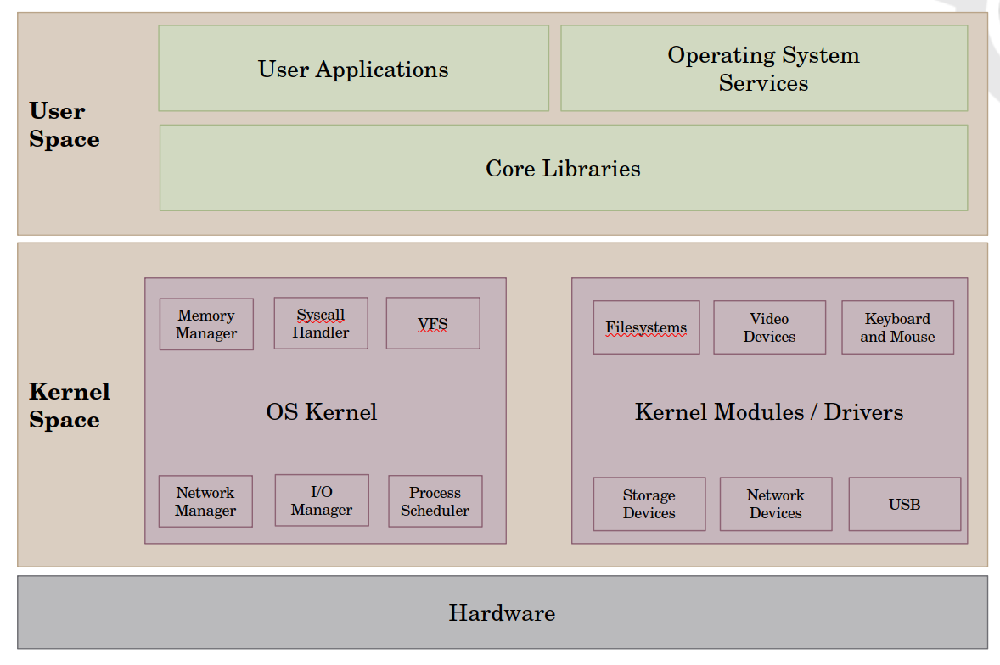
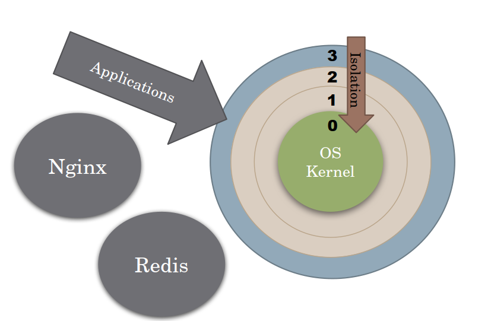

<!-- Slide 1 -->

# Module 2 - Fundamental of Operating Systems

---

<!-- Slide 2 -->

# What is an Operating System (OS)

-   Software layer
-   Manages computer hardware
-   Provides services for computer programs
-   Acts as an intermediary between users and the hardware

---

<!-- Slide 3 -->

# Operating system main functions

-   Resource Management
-   Process and Thread Management
-   Process Isolation
-   Memory Management
-   Input/Output Control
-   File System Management
-   Security and Permissions

---

<!-- Slide 4 -->

# User vs Developer

OS Developer point of view

-   Provides application programming interfaces
-   Provides common services

OS User point of view

-   Operating system is there to execute programs
-   Provides easy interface

---

<!-- Slide 5 -->

# Hardware abstraction

OS provides hardware abstraction for applications

Applications don’t need to know specific hardware details

-   Can run on different processors (e.g., Intel, AMD)
-   No need for separate versions for different processors
-   Works with different storage types and I/O devices transparently (e.g. HDD, SSD)
-   Unaware of how devices are connected (USB, network, wireless)
-   No need to know network connection type (Wi-Fi, Ethernet)

Multiple applications can share the same hardware **simultaneously.**

---

<!-- Slide 6 -->

# History and Evolution of Operating Systems

-   Early Systems (1940s-1950s)
-   Mainframe Era (1960s)
-   The Rise of Unix (1970s)
-   Personal Computers Era (1980s)
-   Modern Operating Systems (1990s-Present)

---

<!-- Slide 7 -->

# Operating system types

Desktop

-   Windows
-   Linux
-   MacOS
-   More…

Server

-   Linux
-   Windows Server
-   Unix – BSD, AIX, HPUX, etc.
-   More…

Mobile

-   Android
-   IOS
-   More…

Embedded

-   Linux
-   Minix
-   Windows IoT Core/Enterprise
-   More…

Real-time (RTOS)

-   QNX
-   RTLinux
-   FreeRTOS
-   More…

---

<!-- Slide 8 -->

# Desktop vs Server OS

**Desktop Operating Systems:**

-   Designed for personal or single-user tasks
-   Focus on user interface, ease of use, and multimedia
-   Optimized for interactive tasks (e.g., browsing, document editing)
-   Examples: Windows, MacOS, Linux (Ubuntu Desktop, Fedora, etc.)

**Server Operating Systems:**

-   Designed to manage and serve multiple users and systems
-   Focus on stability, security, and resource management
-   Optimized for background tasks and services (e.g., databases, web servers)
-   Examples: Linux (Ubuntu Server, RedHat Enterprise Linux, Debian, etc.), Windows Server, Unix-based systems (BSD, AIX, etc.)

---

<!-- Slide 9 -->

# Modern Operating System Architectures



-   Implements core libraries and mechanisms to allow applications to access the hardware resources
-   Applications can make requests to the operating system via syscalls (system calls)
-   Can alert applications via signals

---

<!-- Slide 10 -->

# Kernel

**What is a Kernel?**

-   The core component of the operating system
-   Acts as a bridge between software applications and the hardware of a computer
-   Provides essential services for applications
-   Provides abstraction of hardware components

---

<!-- Slide 11 -->

# Monolithic vs. Microkernel

**Monolithic Kernel**

-   All core functions (process, memory, device, and file management) run in a single space for efficiency

**Microkernel**

-   Minimizes kernel functions
-   Delegates tasks to drivers

**Hybrid Kernel**

-   Combines aspects of both monolithic and microkernels
-   Aims to balance performance and modularity

---

<!-- Slide 12 -->

# Multitasking

CPU Core == Single Task

-   Only one process can be executing at any one time on a single CPU core

What is Multitasking?

-   Allow multiple processes to share same CPU and other system resources

Multitasking operating system

-   OS switches between processes to give the appearance of many processes executing simultaneously

---

<!-- Slide 13 -->

# Cooperative vs Preemptive Multitasking

**Cooperative multitasking**

-   Processes decide for how long it keeps the CPU

**Preemptive multitasking**

-   Processes are not in control for how long they are going to use the CPU

---

<!-- Slide 14 -->

# Protection Rings (a.k.a. Isolation Rings)

-   Protects data and functionality from faults
-   Hardware-enforced by CPU
-   CPU microcode



---

<!-- Slide 15 -->

# Kernel Mode vs. User mode​

To protect critical operating system data, modern OS uses two processor access modes: **user mode** and **kernel mode**

-   User application code runs in user mode (ring 3),
-   OS Kernel (including some system services and device drivers) runs in kernel mode
-   Kernel mode refers to a processor mode that grants access to all system memory and all CPU instructions (ring 0)​

**Note:** Some CPU architectures support more protection rings, but only two are used.​ This is valid for all modern general purpose operating systems.

---

<!-- Slide 16 -->

# Divers and Driver

Device

-   Unit of hardware that performs a special function and is attached to a computer.

Kernel Driver or Module

-   Software program that operates within the kernel space
-   Manages a particular type of **device** or provide purely software-based abstractions (e.g file systems)
-   Manages and translates user I/O function calls into specific hardware device I/O requests

---

<!-- Slide 17 -->

# How OS identifies which driver to load/use?

**Device identification string**

-   The computer devices have a set of registers that identify the vendor and the device model
-   The OS uses those IDs to identify the attached devices and to select the suitable drivers for them

**Example of device identification string**

-   PCI VEN\_10E8 DEV\_4750

---

<!-- Slide 18 -->

# Partitioning

**What is Partitioning?**

-   Dividing a physical disk into separate logical sections

**Why Partition?**

-   Organize data and separate different uses (e.g., OS, data storage, temporary storage)
-   Improve data management and performance
-   Can be formatted with different file systems

---

<!-- Slide 19 -->

# File Systems

**What is a File System?**

-   Defines how data is stored and retrieved on a device

**Functions of a File System:**

-   Organizes and manage files
-   Enables access control and permissions
-   Supports metadata for files (timestamps, size, etc.)

---

<!-- Slide 20 -->

# Files and Directories

**What is a file?**

-   A **file** is a logical grouping of related data
-   It is identified by a filename

**What is a directory?**

-   A **directory** is a hierarchical collection of files and other directories.​

---

<!-- Slide 21 -->

# Processes

What is a process?

-   Represents an instance of a running program
-   OS create a process to run a program
-   Starting an application creates a process

---

<!-- Slide 22 -->

# Threads

-   What is a Thread?
    -   A lightweight **process** that runs within a process
    -   Shares resources (memory, files) with its parent process
    -   Used for parallelism within a single process

---

<!-- Slide 23 -->

# Threads vs Processes

Key Differences

| Feature | Threads | Processes |
| --- | --- | --- |
| **Memory** | Share same memory space | Independent memory space |
| **Overhead** | Lightweight | Heavier due to memory allocation |
| **Context Switch** | Faster | Slower |
| **Creation** | Faster | Slower |
| **Communication** | Easier (shared memory) | More complex (IPC mechanisms) |

  

When to Use Threads

-   Tasks within the same application that can run in parallel
-   Situations requiring low overhead and shared data

---

<!-- Slide 24 -->

# What is a Daemon or Service?

A **Daemon** is a long running **process** that operates in background

-   Provides specific function that is designed to require no user intervention
-   Can be configured to start when the operating system is started
-   Also known as Service in Windows

Example of daemons:

-   Web Server (Apache, Nginx)
-   Database Server (MySql, MongoDB, MSSQL)
-   More…

---

<!-- Slide 25 -->

# Inter Process Communication (IPC)

What is IPC?

-   Mechanism that allows processes to exchange data and communicate
-   Enables coordination between different processes to perform complex tasks and share information efficiently

Why is IPC Important?

-   Resource Sharing
-   Process Synchronization
-   Modularity and Efficiency

---

<!-- Slide 26 -->

# Common IPC Mechanisms

-   Pipes
-   Message Queues
-   Shared Memory
-   Semaphores/Mutex
-   Sockets
-   Unix Sockets

---

<!-- Slide 27 -->

# Linux Specific Concepts

---

<!-- Slide 28 -->

# Users

-   **Regular Users**
    -   Individual accounts for human users
    -   Limited privileges, restricted to their own files and processes.
-   **System Users**
    -   Accounts for services (e.g mysql)
    -   Typically have no login access
-   **Root User**
    -   Superuser account with full system privileges

---

<!-- Slide 29 -->

# Groups

-   **Primary Group**
    -   Default group assigned when a user is created
    -   Every file created by the user belongs to this group
-   **Supplementary Groups**
    -   Additional groups a user belongs to
    -   Grant extra permissions beyond the primary group

---

<!-- Slide 30 -->

# File System Types

| Category | File System | Description |
| --- | --- | --- |
| **General-Purpose** | `ext4` | Default Linux FS for most storage needs |
|  | `XFS` | High-performance, scalable FS |
|  | `Btrfs` | Features snapshots and checksumming |
| **Temporary** | `tmpfs` | Stores files in memory; data lost on reboot |
| **Read-Only** | `ISO 9660` | Standard for CD/DVD storage |
|  | `squashfs` | Compressed, read-only FS for embedded systems |
| **Special/Pseudo** | `procfs` | Virtual FS for process and system info |
|  | `sysfs` | Virtual FS for kernel and hardware interaction |

---

<!-- Slide 31 -->

# Filesystem Hierarchy Standard (FHS)

The standard structured organization of directories and files in Linux

| Directory | Purpose |
| --- | --- |
| `/` | Root directory, starting point of the hierarchy |
| `/bin` | Essential binaries (e.g., `ls`, `cp`, `mkdir`) |
| `/boot` | Bootloader files (e.g., kernel, initrd images) |
| `/dev` | Device files (e.g., `/dev/sda`, `/dev/null`) |
| `/etc` | System configuration files |
| `/home` | User home directories |
| `/lib` | Shared libraries for essential binaries |
| `/mnt` | Temporary mount point for file systems |
| `/opt` | Optional software packages |
| `/proc` | Virtual filesystem for process and system information |
| `/run` | Runtime data for processes since the last boot |
| `/sys` | Interface to kernel information and hardware interaction |
| `/tmp` | Temporary files |
| `/usr` | User applications and libraries |
| `/var` | Variable data (e.g., logs, spool files) |

---

<!-- Slide 32 -->

# File System Mounting

-   **What is Mounting?**
    -   The process of making a file system accessible
    -   A file system is attached to a directory (mount point)
    -   Allows users and applications to interact with storage devices.
-   **Mount Points**
    -   Directories where file systems are mounted (e.g., `/mnt`, `/media`).
    -   Example:

```bash
mount /dev/sda1 /mnt
```

---

<!-- Slide 33 -->

# Persistent Mounts

-   Automatic mounting at boot time
    
-   Achieved using:
    
    -   `/etc/fstab` configuration file
    -   `systemd` mount units
-   Mount information
    
    -   The device or partition (e.g., `/dev/sda1` or UUID).
    -   The mount point (e.g., `/mnt/data`).
    -   The file system type (e.g., `ext4`).
    -   Mount options (e.g., `defaults`).

---

<!-- Slide 34 -->

# Files in Linux

-   Everything in Linux is represented as a file
-   Types of files include:
    -   Regular files
    -   Directories
    -   Device files (Block, Char and Regular)
    -   Symbolic links
    -   Named Pipes
    -   Unix Domain Sockets

---

<!-- Slide 35 -->

# Files in Linux (Type)

The first character in the ls -l output denotes the file type:

| Char | Description |
| --- | --- |
| \- | Regular file |
| d | Directory |
| b | Block device |
| c | Character device |
| l | Symbolic link |
| p | Named pipe (FIFO) |
| s | Unix Socket |

-   Example for character device

```bash
crw-rw----  1 root tty      4,   1 Dec  9 12:00 /dev/tty1          # Character Device
```

---

<!-- Slide 36 -->

# Permissions in Linux

**What are Permissions?**

-   Define access levels for files
-   Three levels of access:
    -   **Read ®**: View file contents or list directory contents.
    -   **Write (w)**: Modify file or directory contents.
    -   **Execute (x)**: Run a file as a program or access a directory.

**Permission Categories**

-   **User (u)**: The owner of the file or directory.
-   **Group (g)**: Users in the file’s group.
-   **Others (o)**: Everyone else.

---

<!-- Slide 37 -->

# Permissions Representation

**Symbolic Notation**: `rwxr-xr--`

```bash
-rw-r--r-- 1 user group 1024 Dec  9 file.txt
```

**Octal Notation**: Numerical representation (`chmod` format 764):

-   `rwxr--r--` = `744`
-   `rw-rw-r--` = `664`

---

<!-- Slide 38 -->

# Managing Permissions

1.  **chmod**: Modify file or directory permissions.
    
    -   Symbolic format: `chmod u+x file.txt`
    -   Octal format: `chmod 755 file.txt`
2.  **chown**: Change ownership of files or directories.
    
    -   Example: `chown user file.txt`
3.  **umask**: Set default permissions for new files and directories.
    
    -   View current umask: `umask`
    -   Set new umask: `umask 022`

---

<!-- Slide 39 -->

# Managing Permissions (cont.)

| Command | Description |
| --- | --- |
| `chmod u+x script.sh` | Add execute permission for the owner |
| `chmod 644 file.txt` | Set read/write for owner, read-only for others |
| `chown newuser file.txt` | Change the owner to `newuser` |
| `chown newuser:newgroup file.txt` | Change the owner and group to `newuser` and `newgroup` |
| `umask 022` | Default files: `644`, directories: `755` |