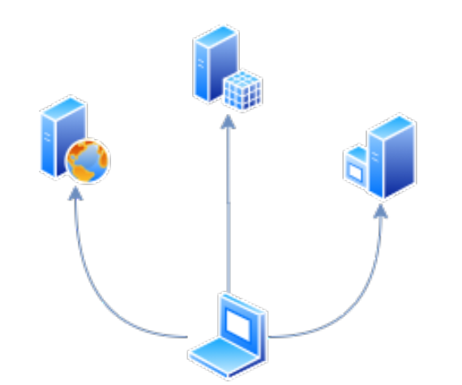
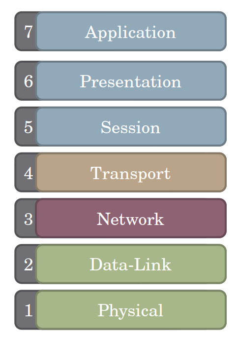
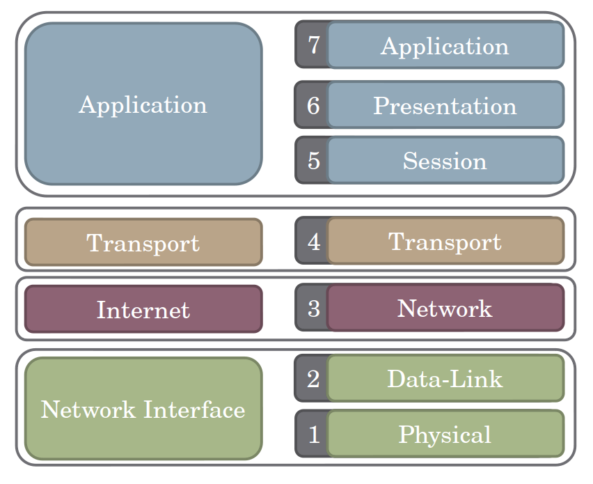
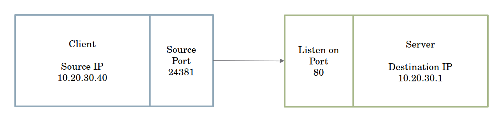
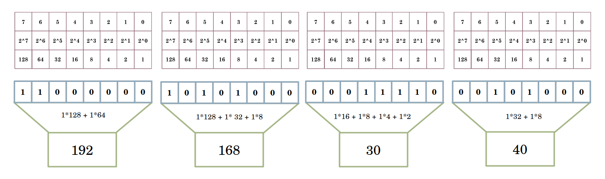
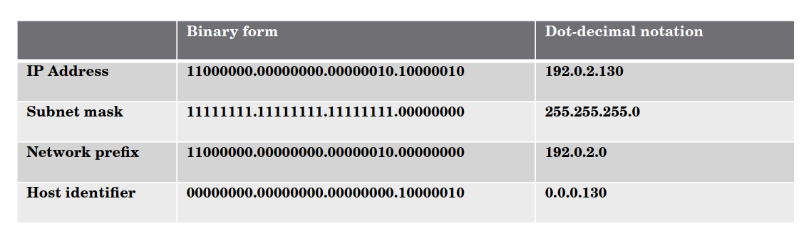
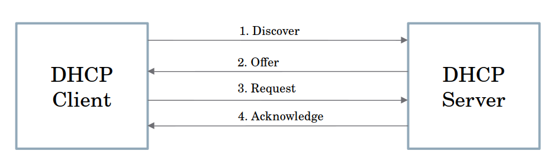
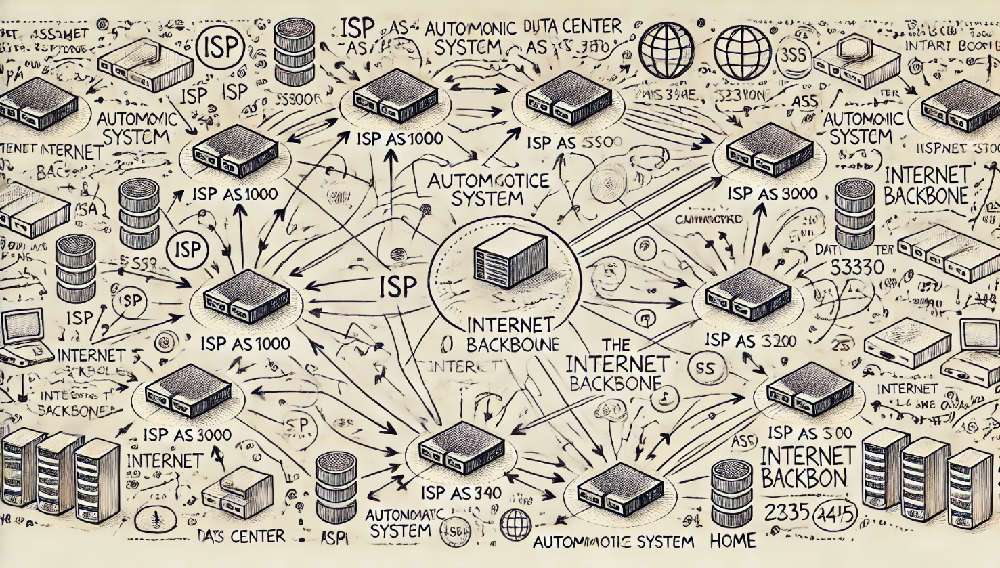
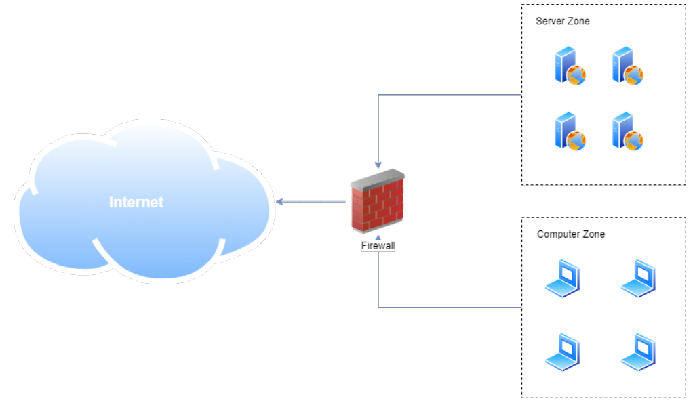
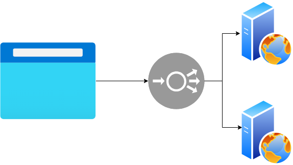

<!-- Slide 1 -->

# Module 3 - Fundamental of Networking

---

<!-- Slide 2 -->

# Network Components

-   Data
-   Client
-   Server
-   Peer
-   Network adapter
-   Network Media
-   Network Devices

---

<!-- Slide 3 -->

# Server vs Client

**Server**

-   Computer that provides shared resources and serves client requests

**Client**

-   Computer that sends requests to other computers in the network



---

<!-- Slide 4 -->

# OSI vs TCP/IP

---

<!-- Slide 5 -->

# OSI Model

-   Open Systems Interconnection model
-   Conceptual/Reference model
-   Defines generic network communication processes
-   Layers communicate (pass information) with the layers above and below them
-   Gives people “jargon” with which to talk about data processing over a network



---

<!-- Slide 6 -->

# TCP/IP Model

-   Transmission Control Protocol/Internet Protocol
-   Developed prior to the OSI model
-   Developed by Department of Defense (DoD) in 1960s
-   Based on standard protocols
-   The “de facto” standard



---

<!-- Slide 7 -->

# Transport Protocols TCP (Layer 4)

**Transmission Control Protocol (TCP)**

-   **Connection oriented**
    -   Establish connection before data can be sent
    -   Uses Three-way handshake
-   **Reliable and Error-checked**
    -   Error detection algorithm
    -   Order algorithm

---

<!-- Slide 8 -->

# Transport Protocols UDP (Layer 4)

**User Datagram Protocol (UDP)**

-   **Simple**
    -   Minimum of protocol mechanisms
    -   Minimum latency
-   **Not connection oriented**
    -   Good for applications that do not require reliable data stream service
    -   Application developers must implement reliability on application layer

---

<!-- Slide 9 -->

# Sockets and Ports

Combination of protocol, port number, source and destination IP address



---

<!-- Slide 10 -->

# Well known application protocols

-   HTTP
-   SMTP
    -   SMTP Server to SMTP Server delivery
    -   SMTP Client to SMTP Server delivery
-   POP3
-   IMAP
-   DNS
-   DHCP
-   FTP
-   SSH
-   RDP
-   VNC
-   NTP

---

<!-- Slide 11 -->

# IP Addressing

---

<!-- Slide 12 -->

# What is an IP Address?

-   Internet Protocol Address
-   Numerical label
-   Each device in **TCP/IP network** has an **IP address**
-   Displayed in human-readable notation
    -   IPV4 - 172.16.254.1
    -   IPV6 - 2001:db8:0:1234:0:567:8:1 (human-readable :D)
-   IP versions
    -   IPV4 (32 bits)
        -   First deployed in 1983 (ARPANET)
    -   IPV6 (128 bits)
        -   First deployed in ~2000
-   Today, we use both versions of the IP simultaneously

---

<!-- Slide 13 -->

# IANA

-   Internet Assigned Numbers Authority (IANA)
    
    -   Global standardization organization (Located in US)
-   Oversees global IP address allocation
    
    -   IPV4 and IPV6
    -   IANA delegates allocations of IP address blocks to regional Internet registries
    -   Each RIR allocates addresses for a different area of the world
    -   IANA manages the global registry of the BGP Autonomous System Numbers (ASNs)
-   Manages the data in the root DNS nameservers
    
-   No more IPV4 public addresses…

---

<!-- Slide 14 -->

# IPV4 Addresses

-   32 Bits
    -   11000000101010000001111000101000
-   4 groups of 8 bits (Octet)
    -   11000000.10101000.00011110.00101000
-   Decimal base
    -   192.168.30.40

---

<!-- Slide 15 -->

# IPV4 Calculation



---

<!-- Slide 16 -->

# Subnet mask (IPV4)

-   Also known as **netmask**
-   Solves some of the problems of classful addressing
-   Consists of **32 bits**
-   Sequence of ones (1) followed by a block of zeros (0)
    -   Ones - indicate bits used for the network prefix
    -   Zeros - designates the host identifier



-   **CIDR** alternate method of representing subnet mask
    -   Count of the number of network bits prefixed with “/” – 192.0.2.130/24

---

<!-- Slide 17 -->

# IPV6

-   128 bits 🛈00100000000000010000110110111000000000000000000000101111001110110000001010101010000000001111111111111110001010001001110001011010
-   8 groups of 16 bits 🛈0010000000000001 0000110110111000 0000000000000000 0010111100111011 0000001010101010 0000000011111111 1111111000101000 1001110001011010
-   HEX base 16 bits 🛈2001:0DB8:0000:2F3B:02AA:00FF:FE28:9C5A
-   Removing leading zeros 🛈2001:DB8:0:2F3B:2AA:FF:FE28:9C5A
-   No subnet mask  
    Prefix Length or just prefix  
    Similar to CIDR in IPV4
-   No broadcast

---

<!-- Slide 18 -->

# DHCP

-   Dynamic Host Configuration Protocol
-   Dynamically assigns network configuration
-   Reducing the need for manual network administration
-   From home networks to big enterprise
-   DORA



-   Discover package is sent to every device in the network (Broadcast)

---

<!-- Slide 19 -->

# DNS

-   Domain Name System
    
-   Hierarchical naming structure - www.my.website.example.com
    
-   Decentralized architecture
    
-   Essential component of the Internet
    
-   Main goal
    
    -   Translates human-readable domain names to the numerical IP addresses
-   Components
    
    -   Name servers
    -   Zones
    -   Resolvers
    -   Records - A, PTR, CNAME, MX, NS, More…

---

<!-- Slide 20 -->

# Wired vs Wireless

-   IEEE
    -   IEEE 802.3 – Ethernet networks
    -   IEEE 802.11 – Wireless local area networks

---

<!-- Slide 21 -->

# Network Adapter

-   Converts instructions from upper layers into
    
    -   Electrical signals
    -   Optical signals
    -   Wireless waves
-   Converts the received signals into meaningful data for the upper layers

---

<!-- Slide 22 -->

# Hub and Switch

**Hub**

-   You can find such devices in a museum
-   Simple signal repeater
-   Supports multiple ports
-   Star wiring and central point of wiring
-   Layer 1 device


**Switch**

-   Same functions as Hub + more
-   Intelligent signal repeater
    -   Understand the source and destination address
    -   Repeats signals only to proper destination ports
-   Layer 2 device
-   Some switches support Layer 3 and Layer 4 features

---

<!-- Slide 23 -->

# VLAN

-   Network traffic isolation
-   Groups physical or virtual devices in a logical network
-   Flexible management
    -   No need to rewire network
    -   No need to move devices

---

<!-- Slide 24 -->

# Overlay Networks

-   Similar to VLAN but for big scale
-   A logical network built on top of a physical network
-   Cloud providers use overlay networks to isolate tenants
-   Overlay links are tunnels through the underlying physical network
-   Many overlay networks may coexist at once
    -   Over the same underlying physical network
    -   And providing its own isolation and services

---

<!-- Slide 25 -->

# Router

-   Layer 3
-   Routes traffic between networks
-   Routes traffic based on routing table
-   Manages routing tables by routing protocols

---

<!-- Slide 26 -->

# Routing Protocols

-   OSPF
-   BGP
-   IS-IS
-   IGRP
-   EIGRP
-   RIP

---

<!-- Slide 27 -->

# Internet

The Internet is a system of interconnected networks that spans the globe



---

<!-- Slide 28 -->

# Intranets and Extranets

**Intranets are:**

-   A group of services hosted on a network
-   A private structure
-   Internet-like service provision

**Extranets are:**

-   Similar services to Intranet
-   Exposed to networks outside of the Intranet
-   Services that require extra security measures

---

<!-- Slide 29 -->

# Firewall

-   A firewall is used to protect a private network from security risks inherent to connecting to an untrusted network
-   Rule based filtering
-   Anti-Virtus (AV) based filtering



---

<!-- Slide 30 -->

# IDS and IPS

**Intrusion Detection System (IDS)**

-   Monitoring the events occurring in your network
-   Analyzing traffic for signatures that match known cyberattacks
-   Analyzing traffic for anomalies

**Intrusion Prevention System (IPS)**

-   the process of performing intrusion detection and then stopping the detected incidents

---

<!-- Slide 31 -->

# VPN

-   Virtual Private Network
-   Method of extending a private network across public networks
-   Encryption is a common part of VPN
-   VPN Use Cases
    -   Remote users
    -   Mobile users
    -   Site-to-Site

---

<!-- Slide 32 -->

# Proxy and Reverse Proxy Servers

**Proxy servers**

-   Cache information
-   Category based filtering
-   Anti-Virtus (AV) based filtering
-   Artificial Intelligent (AI) based filtering
-   Auditing and logging

**Reverse proxy servers**

-   Controlling web traffic
-   Securing web traffic
-   Offload HTTPS
-   Inspect traffic
-   Allow load balancing

---

<!-- Slide 33 -->

# Load Balancer

**What is a load balancer?**

-   System that distributes incoming network traffic across multiple servers
-   Improves the availability, reliability, and performance

**Types of load balancers**

-   Layer 4 (Transport Layer)
    -   Distributes traffic based on IP addresses and TCP/UDP ports
    -   Faster but less flexible since it does not inspect the content of the data
-   Layer 7 (Application Layer)
    -   Distributes traffic based on application-level data, such as HTTP headers, URLs, and cookies
    -   Provides more control and flexibility for web applications

---

<!-- Slide 34 -->

# Load Balancer Key Features

-   Distribute Traffic
    -   Balances incoming requests across multiple servers to prevent overloading any one server
-   Health Checks
    -   Continuously monitors server health and removes unhealthy servers from the pool
-   Fault Tolerance
    -   Ensures high availability by redirecting traffic away from failed or unresponsive servers
-   Scalability
    -   Automatically routes traffic to additional servers when demand increases.



---

<!-- Slide 35 -->

# Common Load Balancing Algorithms

-   Round Robin
    -   Distributes requests to each server in sequential order
-   IP Hashing
    -   Routes traffic based on the client’s IP address (requests from the same client go to the same server)
-   Least Connections
    -   Sends traffic to the server with the fewest active connections
-   Sticky Sessions (Session Persistence)
    -   Ensures that a client’s requests are always directed to the same server

---

<!-- Slide 36 -->

# HTTP

---

<!-- Slide 37 -->

# HTTP

-   Foundation of data communication on the World Wide Web
-   Enables the exchange of hypertext between clients and servers
-   Web Server and Browser
-   Follows a request-response model
-   Secure communications (using HTTPS)
-   Firewall friendly

---

<!-- Slide 38 -->

# HTTP Key Features

-   Human-Readable
    -   HTTP messages are typically in plain text
-   Request-Response Model
    -   Client-server model where a client sends a request, and the server sends a response.
-   Stateless
    -   Each request is independent
    -   The server does not retain information about previous requests
-   Supports Caching
    -   Allows responses to be cached to improve performance
-   Extensible
    -   HTTP supports headers,
    -   Headers allows the client and server to echange additional metadata
-   Uniform Resource Identification (URI)
    -   Uses URIs to identify and locate resources
-   Different Data Formats
    -   Allows for the transfer of various content types

---

<!-- Slide 39 -->

# HTTP Versions

-   HTTP/1.0
    -   Rarely used legacy version
    -   opens a new connection for each request/response pair. And after each response the connection would be closed
-   HTTP/1.1
    -   Widely used version
    -   Supports persistent connections for multiple requests/responses over a single connection
-   HTTP/2
    -   Introduced multiplexing
    -   Allows multiple requests/responses to be handled in parallel over a single connection
    -   Improving performance
-   HTTP/3
    -   Built on QUIC (UDP based protocol), a transport layer protocol that reduces latency, improves performance, and enhances security

---

<!-- Slide 40 -->

# HTTP Methods

-   GET
    -   Retrieve data from the server (e.g., web pages, images)
-   HEAD
    -   Ask for a response identical to a GET request, but without a response body
-   POST
    -   Send data to the server (e.g., form submissions, file uploads)
-   PUT, DELETE, PATCH
    -   Modify or delete resources on the server

---

<!-- Slide 41 -->

# HTTP Status Codes

What are HTTP status codes?

-   Standardized response codes given by servers
-   Indicates the result of a client’s request

**Common Status Code Categories**

-   1xx: Informational
    -   Indicates that the request has been received and is still being processed.
-   2xx: Success
    -   Indicates that the request was successfully received, understood, and processed.
-   3xx: Redirection
    -   Indicates that the client must take additional actions to complete the request.
-   4xx: Client Errors
    -   Indicates that the client’s request contains bad syntax or cannot be fulfilled.
-   5xx: Server Errors
    -   Indicates that the server failed to fulfill a valid request.

---

<!-- Slide 42 -->

# HTTP Headers and Body

**Headers**:

-   Requests and responses contain headers
-   Metadata, such as content type or length

**Body**

-   Optional
-   The data being sent or received

---

<!-- Slide 43 -->

# HTTP Cookies

**What are cookies?**

-   Small blocks of data created by a web server
-   Sent with each request to a server
-   Used to store stateful information (e.g. session identifier)
-   Stored as key-value pairs
-   Delivered using HTTP headers

**Types of Cookies**

-   Session Cookies
-   Persistent Cookies
-   Secure Cookies
-   HttpOnly Cookies

---

<!-- Slide 44 -->

# Modern Communication Protocols in Distributed Systems

---

<!-- Slide 45 -->

# The era before the modern protocols

-   Inter-process communication (IPC)
    
    -   Using pipes, shared memory, message queues, semaphores/mutex, COM, etc.
-   Inter-process communication over network
    
    -   Using sockets, DCOM, RPC, CORBA, RMI, etc.

---

<!-- Slide 46 -->

# Web Services

**HTTP - the “de facto” web services transport protocol**

-   Exchange objects and messages through HTTP protocol
-   Foundation of the World Wide Web
-   Universally accepted
-   Firewall friendly
-   Secure (HTTPS)
-   Variety of tools and languages

---

<!-- Slide 47 -->

# SOAP and REST

**SOAP**

-   Simple Object Access Protocol
-   Strict rules to prepare request and response
-   Web Services Description Language (WSDL)
-   Relies heavily on XML
-   “Legacy”

**REST**

-   Representational State Transfer
-   Not very restrictive
-   Closer to Web in design philosophy
    -   URI based
    -   HTTP Verbs
    -   HTTP Status codes
-   Variety of data formats (XML, JSON, YAML, etc)
-   Foundation for Microservices

---

<!-- Slide 48 -->

# SOAP Example

```xml
HTTP/1.1 200 OK 
Date: Fri, 22 Nov 2013 21:09:44 GMT
Server: Apache/2.0.52 (Red Hat)
SOAPServer: SOAP::Lite/Perl/0.52
Content-Length: 566
Connection: close
Content-Type: text/xml; charset=utf-8
<?xml version="1.0" encoding="UTF-8"?>
<SOAP-ENV:Envelope xmlns:xsi="http://www.w3.org/2001/XMLSchema-instance"
xmlns:SOAP-ENC="http://schemas.xmlsoap.org/soap/encoding/"
xmlns:SOAP-ENV="http://schemas.xmlsoap.org/soap/envelope/"
xmlns:xsd="http://www.w3.org/2001/XMLSchema"
SOAP-ENV:encodingStyle="http://schemas.xmlsoap.org/soap/encoding/">
<SOAP-ENV:Body>
<namesp1:easter_dateResponse xmlns:namesp1="http://www.stgregorioschurchdc.org/Calendar"> 
	<s-gensym3 xsi:type="xsd:string">2014/04/20</s-gensym3>
</namesp1:easter_dateResponse>
     </SOAP-ENV:Body>
</SOAP-ENV:Envelope>
```

---

<!-- Slide 49 -->

# REST Example

```http
GET http://server/employees  HTTP/1.1
Host: server
```

```json
HTTP/1.0 200 OK
Content-Type: application/json
Content-Length: 291
Access-Control-Allow-Origin: *
Server: Werkzeug/0.14.1 Python/3.6.7
Date: Thu, 28 Feb 2019 09:57:01 GMT
[
  {
    "id": 1,
    "name": "John Doe",
    "status": "enabled",
    "lastActionReason": "Hire new Python Developer."
  },
  {
    "id": 2,
    "name": "Doe Johnson",
    "status": "disabled",
    "lastActionReason": "Left the company."
  }
]
```

---

<!-- Slide 50 -->

# REST and OpenAPI

**What is OpenAPI?**

-   Specification for defining RESTful APIs
-   Standardized and machine-readable format (JSON or YAML)
-   Originally known as Swagger
-   OpenAPI provides a structured way to document API endpoints
    -   Request/Response formats
    -   Expected behaviors
-   Allows code generation - Client and Server
-   Provides interactive documentation
-   Simplifies API lifecycle by making it easy to design, document, and share APIs
-   Main contributors - Microsoft, Google, Amazon, Red Hat, IBM and more.

---

<!-- Slide 51 -->

# GraphQL

**What is GraphQL?**

-   Query language for APIs
-   Supports Query (Read) and Mutations (Create, Update, Delete)
-   Designed to provide flexible and efficient interaction with API
-   Developed by Facebook
-   Used by many popular apps like - Facebook, GitHub, Pinterest, Spotify and more.

**GraphQL Principals**

-   Get exactly what you need, nothing more and nothing less
-   Return predictable results
-   Get many resources in a single request
-   Evolve API without versions
-   Uses a schema that defines the structure of the data
-   All requests are sent to a single endpoint

---

<!-- Slide 52 -->

# gRPC

**What is gRPC?**

-   Open-source high-performance communication protocol
-   Designed for building distributed systems and microservices
-   Initially created by Google
-   Uses HTTP/2 as the underlying transport protocol
-   Allows services to communicate efficiently using Protobuf (binary serialization data format)

**gRPC Common Use Cases**

-   Service to Service communication
-   Real-time Applications
-   Polyglot Environments

---

<!-- Slide 53 -->

# gRPC Key Features

-   Efficient Communication
    -   Faster message sizes compared to traditional text-based formats like JSON or XML.
-   Bi-directional Streaming
    -   Supports real-time communication with full-duplex streaming
    -   Client and server can send data simultaneously
-   Strongly Typed Contracts
    -   Define APIs using a .proto file
    -   Ensures type safety and automatic code generation
-   Cross-Language Support
    -   language-agnostic
    -   Supports many languages such as C++, Go, Python, Java, Node.js, and more.

---

<!-- Slide 54 -->

# WebSockets

**What are WebSockets?**

-   Full-duplex communication channel over a single, long-lived connection
-   Allows real-time data exchange
-   Allows bi-directional communication without the need for multiple requests

**WebSockets Common Use Cases**

-   Real-Time Applications
-   Collaborative Tools
-   IoT (Internet of Things)

---

<!-- Slide 55 -->

# WebSockets Key Features

-   Full-Duplex Communication:
    -   Client and server can send and receive messages simultaneously over the same connection
-   Low Latency
    -   No overhead from setting up and tearing down connections
-   Efficient Communication
    -   After the initial connection, messages are exchanged without HTTP headers

---

<!-- Slide 56 -->

# REST vs gRPC vs WebSockets

| **Feature** | **REST** | **GraphQL** | **gRPC** | **WebSockets** |
| --- | --- | --- | --- | --- |
| **Communication Model** | Request/Response | Request/Response | Request/Response & Streaming | Full-Duplex, Persistent |
| **Transport Protocol** | HTTP/1.1 or HTTP/2 | HTTP/1.1 or HTTP/2 | HTTP/2 | TCP (Only the initial WebSocket handshake is HTTP) |
| **Data Format** | JSON, XML (text-based) | JSON | Protobuf (binary format) | Custom (binary or text-based) |
| **Performance** | Moderate (due to text-based payloads) | Moderate (Could be better than REST) | High (due to binary serialization) | High (low-latency, real-time communication) |
| **Use Cases** | Traditional web services, APIs | Fronted oriented APIs | Microservices, inter-service communication | Real-time applications (chat, gaming, IoT) |
| **Streaming** | No built-in support | No built-in support | Bi-directional streaming | Bi-directional streaming |
| **Ease of Use** | Widely adopted, simple to implement | Widely adopted, simple to implement | Requires .proto files, more setup overhead | Simple API, requires persistent connection |
| **Language Support** | Language-agnostic | Language-agnostic | Multi-language support | Language-agnostic |
| **Session Management** | Stateless | Stateless | Stateful | Stateful |
| **Browser Support** | All browsers | All browsers | No browser support | All modern browsers |

---

<!-- Slide 57 -->

# Demos and Labs

-   GitHub Repository
    -   [https://github.com/varadinov/devops\_101\_labs/tree/main/03](https://github.com/varadinov/devops_101_labs/tree/main/03)