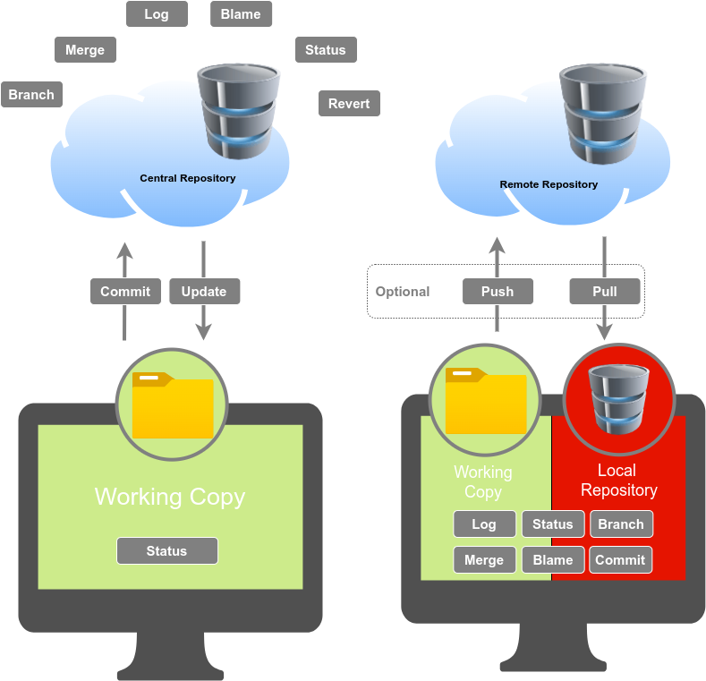
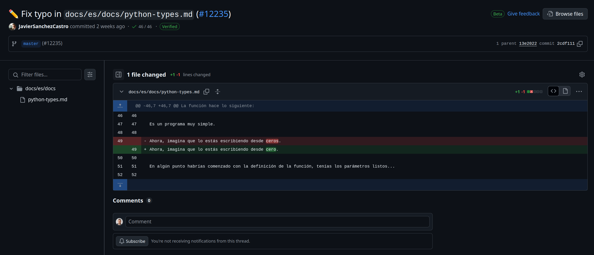
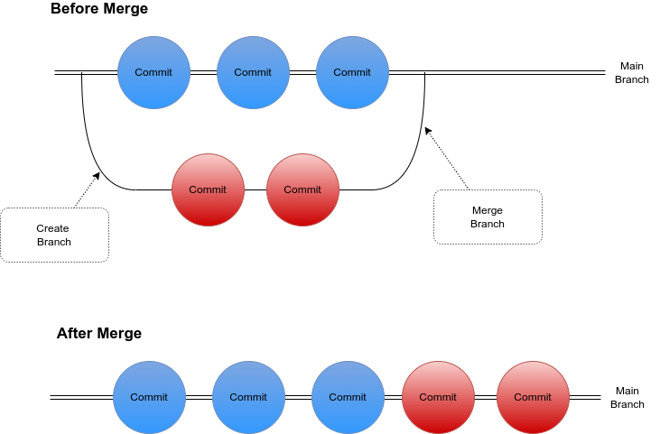
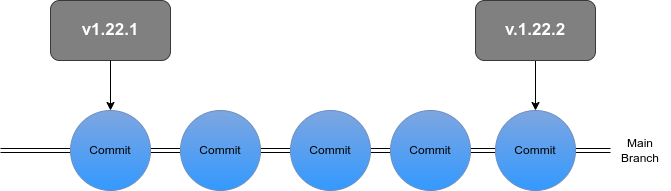
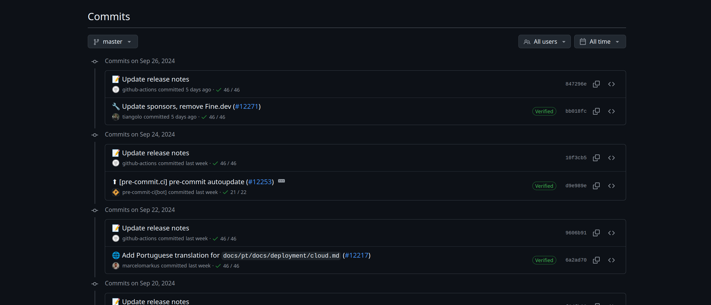
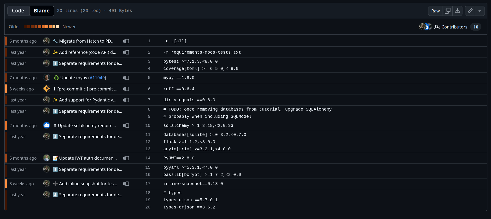
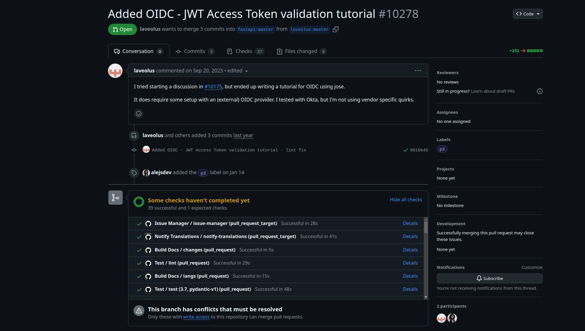

<!-- Slide 1 -->

# Module 05 - Version Control System (VCS)

---

<!-- Slide 2 -->

# What is a Version Control System (VCS)

**Definition**

-   A tool to track and manage changes in code or files over time
-   Enables multiple people to work on the same project

**Key Benefits**

-   Maintains a history of all changes
-   Allows easy rollbacks
-   Supports collaboration
-   Enhances project organization and consistency

**Types**

-   Centralized Version Control
-   Distributed Version Control

---

<!-- Slide 3 -->

# History of Version Control Systems (VCS)

**Early 1970s**

-   Manual file versioning
    -   Developers manually managed code versions
    -   Saving files with different names (e.g., file\_v1, file\_v2).

**Late 1970s - Early 1980s**

-   Source Code Control System (SCCS):
    -   First widely used VCS, developed by AT&T Bell Labs.
    -   Tracked changes in individual files using deltas (differences).

**1986**

-   Revision Control System (RCS):
    -   Storing only recent full file version and then reverse diffs
    -   Focused on versioning single files, not full projects.

---

<!-- Slide 4 -->

# History of Version Control Systems (VCS) (cont.)

**1990s**

-   Concurrent Versions System (CVS):
    -   Enabled multi-developer collaboration on a single codebase
    -   Provided branching and merging, but struggled with large, distributed teams

**2000s**

-   BitKeeper:
    
    -   The first distributed VCS system
    -   Used for the Linux Kernel development
    -   Pioneered many features of distributed version control
-   Subversion (SVN):
    
    -   A centralized VCS designed to fix limitations in CVS.
    -   Supported atomic commits, better handling of binary files, and directory versioning

---

<!-- Slide 5 -->

# History of Version Control Systems (VCS) (cont.)

**Mid-2000s - Present**

-   Distributed Version Control Systems (DVCS):
-   Git (2005):
    -   Revolutionized VCS with a distributed model, fast branching, and merging
    -   Development of Git began after a licensing dispute with BitKeeper in 2005
    -   Became the tool of choice for many major projects, including the Linux Kernel
-   Mercurial (2005): Another popular DVCS with a focus on simplicity and performance

---

<!-- Slide 6 -->

# Centralized VCS (CVCS)

-   Single central repository where all changes are stored
-   Developers check out the latest version, make changes, and commit back to the central server
-   Requires a constant connection to the server for most operations

**Advantages**

-   Simpler setup and easier to manage for small teams
-   Centralized control over access and changes

**Disadvantages**

-   Single point of failure—if the server is down, no commits can be made
-   Limited offline work capabilities

---

<!-- Slide 7 -->

# Distributed VCS (DVCS)

-   Each developer has a full copy of the entire repository (including history)
-   Developers can commit changes locally, work offline, and later synchronize with the remote repository
-   Promotes more collaborative workflows (branching, merging) and parallel development

**Advantages**

-   No single point of failure—local commits and full history are always available
-   Enhanced performance for local operations (commits, history browsing)
-   Encourages experimentation with easier branching and merging

**Disadvantages**

-   Steeper learning curve for new users
-   Larger repository sizes due to distributed copies

---

<!-- Slide 8 -->

# Centralized VCS (CVCS) vs Distributed VCS (DVCS)

---

<!-- Slide 9 -->

# Git

**Definition**

-   A distributed version control system (DVCS) created by Linus Torvalds
-   Created in 2005 for managing the development of the Linux Kernel
-   Allows developers to track changes, manage code history, and collaborate efficiently on projects
-   Open source project

**Key Features**

-   Distributed Model
-   Fast Branching and Merging
-   Commit History
-   Staging Area (Index)
-   Efficient Collaboration

---

<!-- Slide 10 -->

# Git (cont.)

**Advantages**

-   Full offline capabilities—commit, branch, and view history without a network connection
-   Supports non-linear development through powerful branching and merging features
-   Secure and verifiable history due to cryptographic hashing

**Usage in Modern Development**

-   Become the industry standard for version control in open-source and enterprise projects
-   Integrated in platforms like GitHub, GitLab, and BitBucket

---

<!-- Slide 11 -->

# Git Repository

**Definition**

-   Repository (repo) is a storage location for a project’s code, including all files, history of changes and branches
-   Can be local (on your machine) or remote (hosted on platforms like GitHub, GitLab, BitBucket).

**Types of Repositories**

-   Local Repository
-   Remote Repository

**Advantages**

-   Enables collaborative development with remote repositories
-   Allows branching and merging for isolated development without affecting the main code

---

<!-- Slide 12 -->

# Git Commit

**Definition**

-   A commit is a snapshot of the repository at a specific point in time.
-   Records changes made to the code, along with metadata such as the author, date, and a message describing the changes

**Advantages**

-   Provides a clear record of changes made over time
-   Allows developers to roll back to any previous commit if needed
-   Facilitates collaboration, as each team member’s contributions are documented and traceable

---

<!-- Slide 13 -->

# Git Commit Example

  

---

<!-- Slide 14 -->

# Git Push

**Definition**

-   Used to upload local changes from a local Git repository to a remote repository
-   This makes the commits available to others working on the same repository

**Advantages**

-   Collaboration: Ensures team members can see and pull your changes from the remote repository
-   Backup: Your changes are stored in the remote repository, preventing local data loss
-   Branch Management: Easily push new branches or updates to existing branches

---

<!-- Slide 15 -->

# Git Branches

**Definition**

-   A branch is an independent line of development within a repository
-   Allows developers to work on new features, bug fixes, or experiments without affecting the main codebase

**Key Concepts**

-   Main Branch
    
    -   The central, stable branch where the production-ready code resides
    -   Other branches are typically merged into this branch after code reviews and testing
-   Common Other Branch Types
    
    -   Feature Branch: For developing specific features
    -   Release Branch: For preparing final releases with bug fixes and documentation
    -   Hotfix Branch: For addressing critical issues in production

---

<!-- Slide 16 -->

# Merge Branch

  

---

<!-- Slide 17 -->

# Branching Strategies

**Definition**

-   Methods for organizing branches in a Git repository to manage development workflows effectively

**Common Strategies**

-   Git Flow
    
    -   Structured branching model with feature, release, and hotfix branches
    -   main, develop, feature, release, hotfix branches
-   GitHub Flow
    
    -   Simple model
    -   Work directly from main using feature branches
    -   Merge feature branches after review via pull requests
-   Trunk-Based Development
    
    -   Frequent commits to main
    -   Short-lived feature branches

---

<!-- Slide 18 -->

# Git Tags

**Definition**

-   A tag is a label assigned to a specific point in the history of a repository
-   Typically marking an important event or milestone, such as a release.
-   Unlike branches, tags are static and do not change over time.

**Common Use Cases**

-   Releases: Often used to mark specific versions of software, such as v1.0.0, v2.1.5.
-   Milestones: Used to label significant points in the project’s history (e.g., major feature completions)
-   Deployment: Used to identify commits that are ready for deployment to production

---

<!-- Slide 19 -->

# Git Tag

  

---

<!-- Slide 20 -->

# Git History

**Definition**

-   Tracks every change made to a repository over time
-   Each commit represents a snapshot of the repository at a specific point in time,
-   Commits are identified by a unique identifier (SHA-1 hash)

**Advantages of Git History**

-   Traceability: Every change is documented, making it easy to track who made what changes and why
-   Revertibility: Easily revert to previous versions of the code in case of bugs or issues
-   Collaboration: Developers can review past commits and understand the evolution of the project

---

<!-- Slide 21 -->

# Git History Example

  

---

<!-- Slide 22 -->

# Git Blame

**Definition**

-   Tracks the origin of changes in a file, showing which lines were last modified by which developer and in which commit
-   Useful for identifying who made changes, when they were made, and why

**Advantages**

-   Quickly identifies the author of changes
-   Helps understand historical context
-   Can reveal why certain decisions were made or uncover mistakes in code

---

<!-- Slide 23 -->

# Git Blame Example

  

---

<!-- Slide 24 -->

# GitHub, GitLab, BitBucket: Overview

**Definition**

-   Cloud-based platforms
-   Provides hosting for Git repositories
-   Offer additional tools like issue tracking, CI/CD pipelines, and team collaboration
-   Self-Hosted installations

**Key Features**

-   Repository Hosting: Central place for storing Git repositories in the cloud or on self-hosted servers
-   Pull/Merge Requests for code review and merging
-   Issue Tracking to manage bugs and feature requests
-   Code Reviews with inline comments and approvals
-   CI/CD Pipelines: Automates testing, building, and deployment workflows

---

<!-- Slide 25 -->

# GitHub

**Overview**

-   The largest Git hosting platform, widely used for open-source and enterprise projects.
-   Acquired by Microsoft in 2018.

**Key Features**

-   Strong focus on community collaboration through public repositories
-   GitHub Actions for automating CI/CD processes
-   GitHub Pages for hosting project documentation or websites directly from repositories
-   Marketplace for third-party integrations and tools

**Use Cases**

-   Popular for open-source projects and widely adopted by large enterprises

---

<!-- Slide 26 -->

# GitLab

**Overview**

-   A complete DevOps platform offering more than just Git repository hosting
-   Available in both cloud and self-hosted versions

**Key Features**

-   Integrated CI/CD pipelines out of the box
-   GitLab Runner for automating builds, tests, and deployments
-   Supports DevOps lifecycle management, including monitoring, security, and operations
-   Self-hosted option for organizations needing complete control over their infrastructure
-   Free community version for self-hosted option

**Use Cases**

-   Ideal for teams seeking a fully integrated DevOps solution

---

<!-- Slide 27 -->

# BitBucket

**Overview**

-   Focuses on integration with Atlassian products (e.g., Jira, Confluence)
-   Supports Git and Mercurial repositories (though Mercurial support was discontinued in 2020)

**Key Features**

-   Deep integration with Atlassian tools for project management and issue tracking
-   BitBucket Pipelines for CI/CD workflows
-   Self-hosted (BitBucket Server) and cloud-hosted options

**Use Cases**

-   Great for teams already using Atlassian tools for project management and tracking

---

<!-- Slide 28 -->

# Teamwork in GitHub, GitLab and BitBucket

**Collaborative Development**

-   Multiple developers can work on the same codebase simultaneously
-   Changes are isolated using branches, allowing feature development without disrupting the main codebase
-   Special branches can be protected
-   Peer review process

**Benefits for Teams**

-   Streamlined workflows allow for parallel development, increasing team productivity
-   Ensures transparency and visibility of changes within the team
-   Facilitates collaboration regardless of team location (remote or in-house)

---

<!-- Slide 29 -->

# Teamwork in GitHub, GitLab and BitBucket (cont.)

**Branches**

-   Each developer can create their own branch to work on features or bug fixes
-   Branching strategies (e.g., GitFlow, Feature Branch) help organize team workflows

**Pull/Merge Requests**

-   Mechanism for proposing changes from one branch to another
-   Allows for code reviews and discussion before merging into the main codebase
-   Helps maintain code quality and ensures all team members agree on changes

**Code Reviews**

-   Inline commenting allows team members to review and discuss specific lines of code
-   Helps improve code quality and share knowledge across the team

**Issue Tracking**

-   Built-in tools for tracking bugs, features, and project milestones
-   Assign issues to team members, link to pull requests, and close issues when solved

---

<!-- Slide 30 -->

# Git Pull Request Example

  

---

<!-- Slide 31 -->

# Demos and Labs

-   GitHub Repository
    -   [https://github.com/varadinov/devops\_101\_labs/tree/main/05](https://github.com/varadinov/devops_101_labs/tree/main/05)