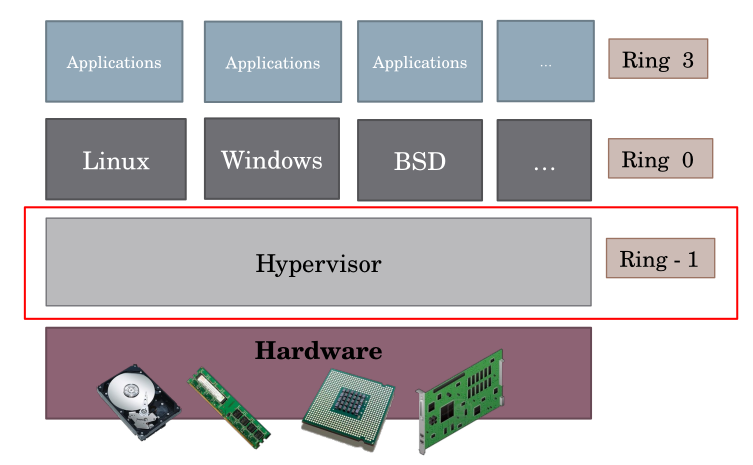
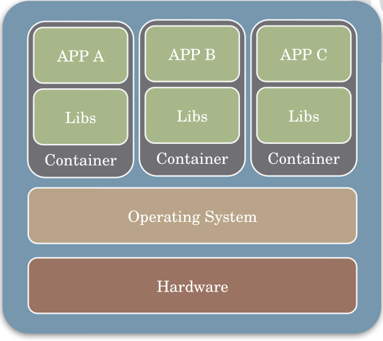
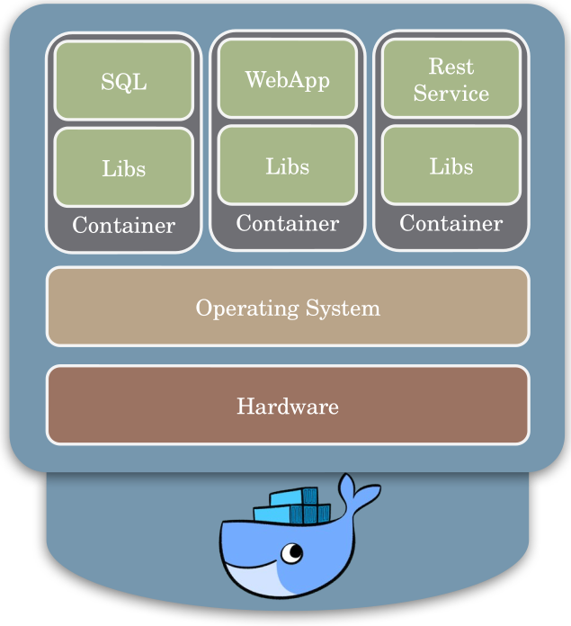
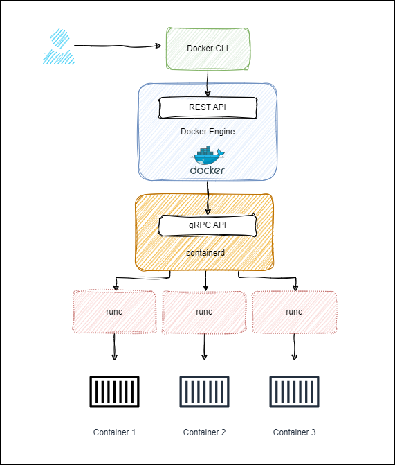
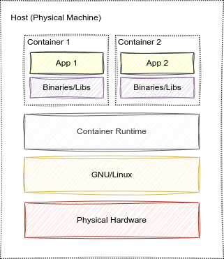
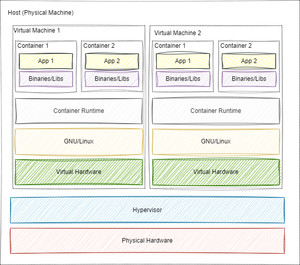
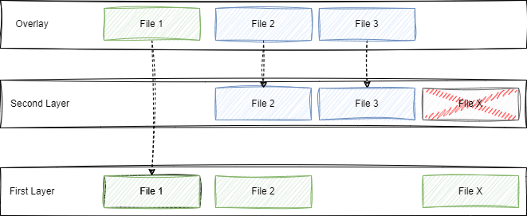

<!-- Slide 1 -->

# Module 6 - Bare Metal, Virtualization, Containers

---

<!-- Slide 2 -->

# Bare Metal

---

<!-- Slide 3 -->

# Understanding Bare Metal

**Definition**

-   OS and applications are installed directly on the physical servers
-   No virtualization layer

**Advantages**

-   High performance
-   Increased security
-   Hardware Customizability
-   Hardware Flexibility

**Disadvantages**

-   Limited scalability
-   Higher cost
-   Low utilization

---

<!-- Slide 4 -->

# Bare Metal – Deployment Strategies

**Install OS**

-   Manual using installation media (usb flash drive)
-   Manual using PXE boot
-   Automatic using Intelligent Platform Management Interface (IPMI) and PXE boot

**Configure OS**

-   Manual configure and harder the OS
-   Automatic using configuration management tools like Ansible

**Install applications**

-   Manual install and configure the applications
-   Automatic using configuration management tools like Ansible

---

<!-- Slide 5 -->

# Virtualization

---

<!-- Slide 6 -->

# What is Virtualization?

  

Virtualization is a term that refers to various techniques, methods or approaches of creating a virtual version of something.

---

<!-- Slide 7 -->

# Virtualization Types

-   Hardware Virtualization
-   Container (OS-Level) Virtualization
-   Application Virtualization
-   Presentation Virtualization
-   More…

---

<!-- Slide 8 -->

# Hardware Virtualization

-   Virtual Machine (VM) acts like a real computer
    
    -   Operating System
    -   Applications
-   Hypervisor
    
    -   The software that creates and manages the virtual machines
-   We also use the terms
    
    -   Guest OS
    -   Host OS

---

<!-- Slide 9 -->

# Full Virtualization

-   Guest OS is unaware that it is virtualized
-   Guest OS does not require any modifications
-   Virtual Machine has all standard components
    -   Virtual processors
    -   Memory
    -   Network Adapters
    -   Virtual Disks

---

<!-- Slide 10 -->

# Para virtualization

-   Guest OS is modified
-   Guest OS is aware that it is running on a hypervisor
-   Guest OS does not communicate directly with the hardware
-   Guest OS communicates with the hypervisior
-   All privileged instructions are replaced with direct calls to the hypervisior

---

<!-- Slide 11 -->

# Hardware assisted virtualization

-   Approach that enables efficient **full virtualization**
-   Uses the capabilities of the hardware



---

<!-- Slide 12 -->

# Hardware assisted virtualization G1

-   The modern CPU’s include hardware assisted virtualization
    -   Intel-VT
    -   AMD-V
-   Introduced first in 2005 (Intel-VT)
-   Allows support for guests without requiring any modifications
    -   No emulation
    -   No instructions translation

---

<!-- Slide 13 -->

# Hardware assisted virtualization G2

-   Second Level Address Translation (SLAT)
    -   Intel VT Extended Page Tables (NPT)
    -   AMD-V Rapid Virtualization Indexing (RVI)

---

<!-- Slide 14 -->

# Hardware assisted virtualization G3, G4, G5

-   Nested Virtualization
-   Memory Management Isolation of I/O device
-   PCI Express Virtualization
    -   Makes one device “look” like multiple devices
    -   Virtual devices appear completely independent
-   Security and isolation features - VM Memory Encryption and other security features

---

<!-- Slide 15 -->

# What we use today?

-   Hardware assisted virtualization!
    
-   But wait! We also use para-virtualized devices
    
    -   Para-virtualized devices are optimized virtual devices designed for Virtualization
    -   Decrease I/O latency
    -   Increase I/O throughput
    -   Provide near bare-metal performance
    -   Needs special device drivers
    -   Often called Hybrid Virtualization
-   Conclusion
    
    -   We use combination of full and para virtualization
    -   OS is not modified since we use the effective hardware assisted virtualization
    -   We use special para-virtualized devices and drivers to provide effective I/O performance

---

<!-- Slide 16 -->

# Example of Hypervisors

-   KVM
-   XEN
-   VMWare ESXi
-   Hyper-V
-   VirtualBox

---

<!-- Slide 17 -->

# Virtualization Benefits

-   Resource Efficiency
-   Cost Savings
-   Improved Disaster Recovery
-   Isolation and Security
-   Simplified Management

---

<!-- Slide 18 -->

# Containers

---

<!-- Slide 19 -->

# Containers

-   Form of operating system virtualization/isolation
-   OS Kernel creates multiple isolated user space instances
    -   Process from one user space sees only it’s space
    -   Process from one user space “cannot” affect process of another user space
-   This makes them more lightweight and portable than VMs
-   The “de facto” standard for modern architectures

---

<!-- Slide 20 -->

# Brief History of Containers

-   1979 - Chroot
-   2000 - FreeBSD Jails
-   2001 - Linux VServer
-   2004 - Solaris Containers
-   2005 - Open VZ (Open Virtuozzo)
-   2007 - Control groups (cgroups)
-   2008 - LXC (LinuX Containers)
-   2013 – Docker
-   2015 – Kubernetes (Containers Orchestration)
-   2016 – Windows Native Containers
-   More…

---

<!-- Slide 21 -->

# Containers Isolation (Namespaces and CGroups)

-   Namespace isolation
    
    -   Process tree
    -   Networking
    -   User IDs
    -   File Systems (Mounts)
    -   IPC
-   Resource limitation (cgroups)
    
    -   CPU
    -   Memory
    -   I/O
    -   Network



---

<!-- Slide 22 -->

# Containers Advantages

**Portability**

-   Runs on any system that supports containerization
-   Ensure consistency across different environments

**Efficiency**

-   Uses fewer resources than virtual machines
-   Faster to start and more lightweight

**Isolation**

-   Each container runs in its own isolated environment
-   Issues in one container don’t affect others

**Scalability**

-   Easy to scale horizontally
-   Ideal for cloud-native applications and modern architectures

---

<!-- Slide 23 -->

# Docker

---

<!-- Slide 24 -->

# What is Docker?

-   Creating, working with, and managing containers
-   Standardized packaging for software
-   Simplify building, shipping, running apps
-   Isolate apps from each other
-   Share the same OS kernel
-   Works for all major Linux distributions
-   Open Source platform



---

<!-- Slide 25 -->

# Docker the "de-facto" standard

-   2014 RedHat Summit
    -   Alan Shimel: "Docker is becoming synonymous with containers in Linux"
-   Introduced an easy-to-use platform
-   Containerization accessible to developers
-   Simplified packaging applications
-   Easier to run applications consistently

---

<!-- Slide 26 -->

# Why Docker Containers?

-   Easily package your application
-   Build once, run anywhere
-   Consistent deployment
-   Use less resources compared to virtual machines
-   Faster startup times
-   Runs independently, isolating applications from each other
-   Can be easily scaled up or down based on demand
-   Enabler for modern architectures

---

<!-- Slide 27 -->

# Docker Architecture



---

<!-- Slide 28 -->

# Docker on Bare Metal



---

<!-- Slide 29 -->

# Docker on Virtual Machine



---

<!-- Slide 30 -->

# Docker Components

**Docker CLI**

-   Tool that allows users to interact with Docker from the command line

**Docker Engine**

-   Creates, ships and runs Docker containers on physical or virtual machine

**Docker Image**

-   The basis of a Docker container
-   Represents a full application with all dependencies

**Registry Service**

-   Storage and distribution service for your images

**Docker Container**

-   The standard unit in which the application executes

---

<!-- Slide 31 -->

# Docker CLI

-   Command-Line Interface (CLI)
    
-   Allows interaction with Docker from the command line
    
-   Manage Docker resources
    
    -   Images
    -   Containers
    -   Volumes
    -   Networks
-   CLI Principle
    
    -   docker subcommand action additional-parameters
    -   Example: docker run -d -p 3000:3000 ealen-server

---

<!-- Slide 32 -->

# Docker Engine

**What is the Docker Engine?**

-   The core software behind Docker
-   Responsible for containers management

**Components**

-   Docker Daemon
    -   Background service
    -   Implements REST API
-   Image Management
    -   Pulling and Pushing
    -   Building
-   Container Management
    -   Starting and Running Containers
    -   Manages Networking

---

<!-- Slide 33 -->

# Docker Image

-   A read-only template
-   Contains the application code, libraries, dependencies
-   Contains also configuration needed to run a container
-   Built using a series of layers
-   Can be easily reused across different environments

---

<!-- Slide 34 -->

# Docker and Union Filesystem

-   Layers multiple filesystems to create a single unified view
-   Stacks multiple layers to form a complete filesystem
-   Read-Only and Read-Write Layers
    -   Read-Only Layers: Base image layers shared among containers
    -   Read-Write Layer: Added on top, storing changes specific to that container

  



---

<!-- Slide 35 -->

# Building Docker Images: Interactive vs. Dockerfile

-   Interactive Mode
    
    -   Build images interactively by manually entering commands
    -   Start a base container interactively
    -   Execute commands (e.g., install software, modify files)
    -   Commit changes to a new image
    -   Good only for quick testing or prototyping
-   Dockerfile
    
    -   Build image using a declarative text file containing instructions
    -   Define the Dockerfile with all instructions
    -   Build the new image
    -   Automation-friendly, supporting CI/CD pipelines

---

<!-- Slide 36 -->

# Dockerfile

-   Text file
-   Set of instructions to build a Docker image
-   Defines how the container environment is created
-   Includes instructions for
    -   Base image
    -   Software dependencies
    -   Configurations
    -   Application files
    -   Other required files
-   Can be versioned along with the application code
-   Can be used to build identical images on different machines

---

<!-- Slide 37 -->

# Dockerfile Instructions

-   **FROM:** Specifies the base image to build upon
-   **RUN:** Executes commands to install dependencies or perform setup tasks
-   **COPY:** Copies files or dirs from the host system to the container
-   **ADD:** Copies files or dirs plus extract compressed files and download from url
-   **CMD or ENTRYPOINT:** Defines the command or script to be run when the container starts
-   **WORKDIR:** Change working directory
-   **ENV:** Set environment variables
-   **EXPOSE:** Describe which network ports your application is listening on

  

-   **Reference:** [https://docs.docker.com/reference/dockerfile/](https://docs.docker.com/reference/dockerfile/)

---

<!-- Slide 38 -->

# Dockerfile Simple Example

```dockerfile
FROM python:3.8
WORKDIR /app
COPY . /app
RUN pip install -r requirements.txt
CMD ["python", "app.py"]
```

---

<!-- Slide 39 -->

# Dockerfile Multi-stage builds

```dockerfile
# First stage: build dependencies
FROM python:3.11-slim AS builder
WORKDIR /app
RUN apt-get update && apt-get install -y --no-install-recommends build-essential 
COPY requirements.txt .
RUN python -m venv /opt/venv \
    && . /opt/venv/bin/activate \
    && pip install --upgrade pip \
    && pip install -r requirements.txt

# Copy the virtual environment from the builder stage
FROM python:3.11-slim AS production
WORKDIR /app
COPY --from=builder /opt/venv /opt/venv
COPY app .
EXPOSE 8000
ENV PATH="/opt/venv/bin:$PATH"
CMD ["uvicorn", "main:app", "--host", "0.0.0.0", "--port", "8000"]
```

---

<!-- Slide 40 -->

# Working with Images

-   Pull an image

```bash
docker pull image-name
```

-   List images

```bash
docker images
```

-   Remove an image

```bash
docker rmi image-name
```

-   Build image

```bash
docker build . -t image-name
```

-   View image details

```bash
docker inspect image-name
```

-   Push image

```bash
docker push my-username/my-image
```

---

<!-- Slide 41 -->

# .dockerignore file

-   Exclude unnecessary files and directories from the image
    -   sensitive files, temp files, logs, build artifacts, etc.
-   Supports [glob](https://docs.docker.com/build/concepts/context/#dockerignore-files) patterns (e.g., \*.log, temp/)
-   Allows negation patterns with ! to include files

```text
__pycache__/
*.pyc
*.pyo
venv/
*.log
*.tmp
.env
config/*.secret
data/*
!data/important-data.json
```

---

<!-- Slide 42 -->

# Docker Registry

**What is a Registry?**

-   Storage and distribution system for Docker images
-   Public Registry: Docker Hub is the most widely used public registry
-   Private Registry: Setup a private registry to store images securely within your organization

**Key Concepts**

-   Repository
    -   A collection of related images
    -   Typically with different tags. E.g., myapp:latest, myapp:v1.0
-   Image Tags
    -   Labels that represent specific versions of an image
    -   Common tags include latest and version numbers

---

<!-- Slide 43 -->

# Working with Registry

**What is Registry?**

-   Login

```bash
docker login registry_url
```

-   Tag image

```bash
docker tag local_image registry_url/registry_url:tag
```

-   Push

```bash
docker push registry_url/registry_url:tag
```

-   Pull

```bash
docker pull registry_url/registry_url:tag
```

---

<!-- Slide 44 -->

# Docker Container

-   A running instance of a Docker image
-   Isolated and lightweight
-   Designed to be stateless

**Key Commands**

-   Run a container: docker run image-name
-   List running containers: docker ps
-   Remove a container: docker rm container-name

---

<!-- Slide 45 -->

# Working with Containers

-   Run container

```bash
docker run -d --name myapp image
```

-   Run in Interactive Mode

```bash
docker run -it --name myapp image /bin/bash
```

-   Stop a Running Container

```bash
docker stop myapp
```

-   Start a Stopped Container

```bash
docker start myapp
```

-   Remove container

```bash
docker rm myapp
```

---

<!-- Slide 46 -->

# Environment Variables and Ports Mapping

-   Provide environment variables

```bash
docker run -e VAR_NAME=var_value -d --name myapp myimage
```

-   Map ports

```bash
docker run -p 8000:8000 -it --name myapp myimage
```

---

<!-- Slide 47 -->

# Troubleshoot Containers

-   Inspect container

```bash
docker inspec container-name
```

-   View logs

```bash
docker logs container-name
```

-   Attach to running container

```bash
docker attach container-name
```

**Note:** You can dettach by pressing Ctrl + P and Ctrl + Q

-   Exec commands in running container

```bash
docker exec container-name ps
```

-   Exec interactive commands in running container

```bash
docker exec -it container-name /bin/bash
```

---

<!-- Slide 48 -->

# Docker Volumes

-   Persistent storage solution for Docker containers
-   Data persists even if the container is deleted
-   Managed outside the container’s filesystem
-   Making backups and migrations easier

---

<!-- Slide 49 -->

# Types of Docker Volumes

-   Volume
    -   Stored in host directory (default /var/lib/docker/volumes/)
-   Bind Mount
    -   Links to a specific directory or file on the host system
-   tmpfs Mount
    -   Stores data in memory, creating a temporary filesystem

---

<!-- Slide 50 -->

# Creating and Using Volumes

-   Creating a Volume

```bash
docker volume create my-volume
```

-   Attaching a Volume to a Container

```bash
docker run -v my-volume:/data my-container
```

-   Inspecting a Volume

```bash
docker volume inspect my-volume
```

-   Deleting a Volume

```bash
docker volume rm my-volume
```

---

<!-- Slide 51 -->

# Mount directory or file (Bind Mounts)

-   Mount directory

```bash
docker run -v /host/dir:/container/dir my-container
```

-   Mount file

```bash
docker run -v /host/file:/container/file my-container
```

---

<!-- Slide 52 -->

# Docker Networking

-   Enables communication between
    
    -   Containers
    -   Services
    -   External networks
-   Types of Docker Networks:
    
    -   None
    -   Bridge
    -   Host
    -   Overlay

---

<!-- Slide 53 -->

# Managing Docker Networks

-   List networks

```bash
docker network ls
```

-   Create network

```bash
docker network create network-name
```

-   Inspect network details

```bash
docker network inspect network-name
```

-   Remove a network

```bash
docker network rm netowrk-name
```

-   Run container in a network

```bash
docker run --network network-name --name my-container -d nginx
```

---

<!-- Slide 54 -->

# Docker Compose

-   Define and manage multi-container Docker applications
-   Using a single YAML configuration file (docker-compose.yml)
-   Simplifies managing interdependent services
    -   Web App
    -   Database
    -   Cache

**Key Commands**

-   Start Compose

```bash
docker-compose up -d
```

-   Destroy Compose

```bash
docker-compose down
```

---

<!-- Slide 55 -->

# Docker Compose Example

```yaml
version: '3.8'
services:
  web:
    image: my-fastapi-app 
    container_name: my-fastapi-app
    ports:
      - "8000:8000"  # Expose FastAPI on port 8000
    environment:
      - POSTGRES_PASSWORD=${POSTGRES_PASSWORD}
      - DATABASE_URL=postgresql://postgres:${POSTGRES_PASSWORD}@db/postgres 
    depends_on:
      - db
  db:
    image: postgres:13
    container_name: postgres-db
    environment:
      - POSTGRES_PASSWORD=password
    volumes:
      - postgres_data:/var/lib/postgresql/data  # Persistent storage for database

volumes:
  postgres_data:  # Create Persistent storage
```

---

<!-- Slide 56 -->

# Container Orchestrators

---

<!-- Slide 57 -->

# Container Orchestrators Overview

-   Tools that automate
    -   Deployment
    -   Management
    -   Scaling of containers
-   Main Goals:
    -   Automation
    -   Distributed Deployment
    -   Resource Efficiency
    -   Scalability
    -   High Availability

---

<!-- Slide 58 -->

# Popular Container Orchestrators

-   Kubernetes
-   Hashicorp Nomad
-   Docker Swarm
-   Apache Mesos

---

<!-- Slide 59 -->

# Demos and Labs

-   GitHub Repository
    -   [https://github.com/varadinov/devops\_101\_labs/tree/main/06](https://github.com/varadinov/devops_101_labs/tree/main/06)

---

<!-- Slide 60 -->

# Additional Slides

---

<!-- Slide 61 -->

# Images Best Practices

-   Use official or verified base images whenever possible
-   Minimize the number of layers in your image
-   Order commands for maximum layer caching
-   Avoid unnecessary tools and dependencies
-   Leverage .dockerignore to exclude unnecessary files
-   Use multistage builds to optimize image size.
-   Pin specific versions of dependencies to ensure consistency
-   Regularly scan images for vulnerabilities
-   Remove sensitive data like credentials from images

---

<!-- Slide 62 -->

# Docker Best Practices

-   Container should run a single application
-   Keep containers stateless and immutable
-   Use environment variables for sensitve data
-   Mount config files to avoid hardcoded configurations
-   Set resource limits (memory and CPU) for containers
-   Log to stdout and stderr for centralized logging
-   Always tag images with meaningful and versioned tags
-   Use a private container registry for custom images