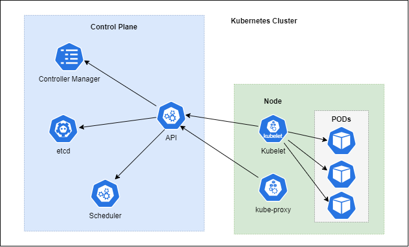

<!-- Slide 1 -->

# Module 7 - Kubernetes

---

<!-- Slide 2 -->

# Kubernetes Basics

---

<!-- Slide 3 -->

# Before we cover Kubernetes - What is CNCF?

-   Cloud Native Computing Foundation
-   A foundation under the Linux Foundation
-   Promote the adoption of cloud-native computing
-   Sustaining open-source projects and technologies
-   Includes platinum, gold, silver, and end-user members
-   Hosts events like KubeCon and CloudNativeCon
-   Example Projects: Kubernetes, Helm, OpenTelemetry, Prometheus
-   Project Lifecycle: Sandbox, Incubating, Graduated
-   Landscape: [https://landscape.cncf.io/](https://landscape.cncf.io/)

---

<!-- Slide 4 -->

# What is kubernetes?

-   Container orchestration platform
-   Cluster management platform
-   Automates containerized and distributed applications
-   Abstracts away the underlying hardware
-   Developed by Google
-   Open-Source platform
-   Encourages declarative and automation paradigms
-   Often abbreviated as K8s
-   Works across on-premises, cloud, and hybrid environments

---

<!-- Slide 5 -->

# Kubernetes Distributions

-   Customized versions of the upstream Kubernetes (vanilla)
-   Include additional tools, configurations, and integrations
-   Often provide enterprise features and support
-   CNCF includes dozens of distributions
-   Popular Distributions
    -   Cloud Based: Amazon EKS, Azure AKS, Google Kubernetes Engine (GKE)
    -   Enterprise: OpenShift, VMware Tanzu
    -   Single-Node: Minikube, Kind

---

<!-- Slide 6 -->

# Kubernetes Core Features

-   Service discovery
-   Load balancing
-   Storage orchestration
-   Automated rollouts and rollbacks
-   Self-healing ideology
-   Declarative definitions
-   Secret and configuration management
-   Automatic scaling

---

<!-- Slide 7 -->

# Types of supported applications

-   Stateless
-   Stateful
-   Data-processing

**Note:** If an application can run in a container, it should run great on Kubernetes.

---

<!-- Slide 8 -->

# Kubernetes does not

-   Deploy source code
-   Build your application
-   Provide application-level services:
    -   Middleware services (message busses)
    -   Databases
    -   Caches
    -   Cluster storage systems
-   Dictate logging, monitoring, or alerting solutions

---

<!-- Slide 9 -->

# Kubernetes Cluster

-   The heart of Kubernetes
-   Set of nodes that run containerized applications
-   Aims to run containers
    -   Efficiently
    -   Automated
    -   Distributed
    -   Scalable
-   Decouples the containers from the underlying hardware layer

---

<!-- Slide 10 -->

# Installing Kubernetes Cluster

-   Managed Kubernetes services
    -   AWS
    -   Azure
    -   Google Cloud
-   Self-hosted Kubernetes
-   Local environment
    -   Ideal for learning, testing, and development
    -   minikube
    -   kind

---

<!-- Slide 11 -->

# KIND

-   Run local Kubernetes clusters in Docker containers
-   KIND == Kubernetes IN Docker
-   Primarily designed for learning and testing
-   Can be used also for local development

---

<!-- Slide 12 -->

# Kubernetes Config file

-   YAML kubeconf file
-   Default location is ~/.kube/config
-   KUBECONFIG environment variable holds a list of kubeconfig files
-   Used to manage and access multiple Kubernetes clusters
-   Stores information on clusters, users, and contexts
-   Structure
    -   Clusters: Defines each Kubernetes cluster to connect to
    -   Users: Holds authentication details for accessing clusters
    -   Contexts: Combines a cluster, user, and namespace for easy access

---

<!-- Slide 13 -->

# kubectl

-   The official kubernetes CLI client
-   Interacts with the Kubernetes API
-   Syntax
    -   kubectl <action> <resource> <obj-name>

Output:

-   By default is human readable
-   Extended information: -o wide
-   \-o json or -o yaml

---

<!-- Slide 14 -->

# Namespaces

-   Isolating groups of resources
-   Used to organize objects
-   Single cluster – Multiple namespaces
-   Applicable only for namespace objects (e.g. Deployments, Services, PODs, etc)
-   Intended for use in multi-tenant environments

---

<!-- Slide 15 -->

# kubectl and namespaces

-   By default **kubectl** interacts with the '**default**' namespace
-   Specify other namespace
    -   –namespace (-n) flag
-   Use all namespaces
    -   –all-namespaces flag

---

<!-- Slide 16 -->

# kubectl and contexts

-   List All Contexts

```bash
kubectl config get-contexts
```

-   Switch Context

```bash
kubectl config use-context context-name
```

-   View Current Context

```bash
kubectl config current-context
```

-   Set Default Namespace

```bash
kubectl config set-context --current --namespace=namespace-name
```

---

<!-- Slide 17 -->

# Kubernetes Resources

-   Building Blocks of the Cluster
-   Fundamental components that define and maintain applications
-   Example of resources:
    -   POD
    -   Service
    -   ReplicaSet
    -   Deployment

---

<!-- Slide 18 -->

# Kubernetes Manifest Files

-   Define Kubernetes Resources
-   YAML or JSON files
-   Declare the desired state

```yaml
apiVersion: v1
kind: Pod
metadata:
  name: my-app
spec:
  containers:
    - name: my-container
      image: my-app:1.22.0
```

---

<!-- Slide 19 -->

# kubectl Imperative vs Declarative

-   Imperative
    -   Execute imperative commands to describe resources
    -   Good for troubleshooting and experimenting
    -   Not recommended for production deployments

```bash
kubectl run nginx --image=nginx
```

-   Declarative
    -   Define a manifest file that describes the resources
    -   Apply the the desired state

```bash
kubectl apply -f nginx.yaml
```

---

<!-- Slide 20 -->

# PODs

-   Basic building block
-   Smallest deployable units
-   Group of one or more containers
    -   Deeply coupled
    -   Shared network
    -   Shared storage
-   Multiple containers in one POD
    -   Combining multiple primary workloads in single pod is an anti-pattern
    -   Sidecar containers, proxies, bridges, adapters, etc.

---

<!-- Slide 21 -->

# PODs (cont.)

-   Each container runs in its own cgroup
-   Share OS namespaces
-   Share IP Address and Port (network namespace)
-   Share hostname
-   Share IPC

---

<!-- Slide 22 -->

# PODs (cont.)

-   Create POD (Imperative)

```bash
kubectl run nginx --image=nginx
```

-   Create POD (Declarative)

```bash
kubectl apply -f - <<EOF
apiVersion: v1
kind: Pod
metadata:
  name: nginx
spec:
  containers:
    - name: nginx
      image: nginx:latest
EOF
```

-   Delete POD

```bash
kubectl delete nginx
```

---

<!-- Slide 23 -->

# Troubleshooting PODs

-   Read pod logs

```bash
kubectl logs pod-name
```

-   Execute command in running container

```bash
kubectl exec -it pod-name -- /bin/bash
```

-   Attach to running container

```bash
kubectl attach -it pod-name 
```

-   Copy files

```bash
kubectl cp pod-name:/path/to/local/file path/to/local/file
```

-   Forward traffic from local 8080 to confiner 80

```bash
kubectl port-forward pod-name 8080:80
```

---

<!-- Slide 24 -->

# Containers Health Checks / Probes

-   Mechanisms to monitor the status of an application
-   Kubelt takes action if the application is unhealthy or unresponsive
-   Types:
    -   Startup probe
    -   Liveness probe
    -   Readiness probe
-   Probe type:
    -   HTTP
    -   TCP
    -   gRPC
    -   exec (run script and exit with code 0)

---

<!-- Slide 25 -->

# Containers Health Checks / Probes (cont.)

```yaml
apiVersion: v1
kind: Pod
metadata:
  name: my-app-pod
spec:
  containers:
    - name: my-app-container
      image: my-app:latest
      imagePullPolicy: Never
      ports:
        - containerPort: 8000
      livenessProbe:
        httpGet:
          path: /health
          port: 8000
        initialDelaySeconds: 5
        periodSeconds: 10
      readinessProbe:
        httpGet:
          path: /health
          port: 8000
        initialDelaySeconds: 5
        periodSeconds: 5
```

---

<!-- Slide 26 -->

# Requests and Limits

-   Control the resources of a container
-   By default, containers run with unbounded compute resources
-   Applied per container in POD
-   Requests
    -   Minimum guaranteed amount of a resource
    -   Used when scheduling PODs to nodes
    -   Scheduler ensures all requests for all pods do not exceed the node capacity
-   Limits
    -   Maximum amount of a resources to be used
    -   Container can never consume more than the limit
    -   Relays on cgroups in the Linux Kernel

---

<!-- Slide 27 -->

# Requests and Limits (cont.)

```yaml
apiVersion: v1
kind: Pod
metadata:
  name: my-app-pod
spec:
  containers:
    - name: my-app-container
      image: my-app:latest
      imagePullPolicy: Never
      ports:
        - containerPort: 8000
      resources:
        # Define the minimum required recourses to schedule the pod
        requests:
          memory: "128Mi"
          cpu: "250m"
        # Define the maximum resources that the pod can consume
        limits:
          memory: "256Mi"
          cpu: "500m"
```

---

<!-- Slide 28 -->

# Labels and Annotations

-   **Labels**
    
    -   Key/Value pairs
    -   Attached to objects (e.g. Pods)
    -   Used to specify identifying
    -   Used in selectors
    -   Used to organize and to select subsets of objects
-   **Annotations**
    
    -   Key/Value pairs
    -   Attached to objects (e.g. Pods)
    -   Attach arbitrary non-identifying metadata to objects
    -   Provide information that is useful to other tools
    -   Cannot be used in selectors

---

<!-- Slide 29 -->

# Labels and Annotations (cont.)

```yaml
apiVersion: v1
kind: Pod
metadata:
  name: example-pod
  labels:
    app: my-app
    env: production
  annotations:
    last-updated: "2024-11-08"
spec:
  containers:
  - name: my-container
    image: nginx:latest
```

---

<!-- Slide 30 -->

# Service

-   Discovery
-   Load balancing
-   Provides stable name
-   Types of Services:
    -   ClusterIP
    -   NodePort
    -   LoadBalancer
    -   ExternalName

---

<!-- Slide 31 -->

# Service (cont.)

```yaml
apiVersion: v1
kind: Service
metadata:
  name: my-app-service
spec:
  type: NodePort
  selector:
    app: my-app
  ports:
    - protocol: TCP
      port: 8000          # Port on the Service
      targetPort: 8000    # Port on the Pod
      nodePort: 30000     # Specific NodePort
```

---

<!-- Slide 32 -->

# Replication sets (ReplicaSet)

-   Ensures a specified number of pod replicas are running
-   Automatically manages pod creation and deletion
-   Key Functions:
    -   Self-healing
    -   Scaling

---

<!-- Slide 33 -->

# Replication sets (cont.)

```yaml
apiVersion: apps/v1
kind: ReplicaSet
metadata:
  name: my-app-replicaset
  labels:
    app: my-app
spec:
  replicas: 3
  selector:
    matchLabels:
      app: my-app
  template:
    metadata:
      labels:
        app: my-app
    spec:
      containers:
      - name: my-app-container
        image: my-app:latest
        ports:
          - containerPort: 8000
```

---

<!-- Slide 34 -->

# Deployments

-   Deployment and scaling of containerized applications
-   Uses ReplicaSets but adds additional functionality
-   Describe the desired state of the application
-   Easy version updates for any software (Rolling Updates)

---

<!-- Slide 35 -->

# Deployments

```yaml
apiVersion: apps/v1
kind: Deployment
metadata:
  name: nginx-deployment
spec:
  replicas: 3
  selector:
    matchLabels:
      app: nginx
  template:
    metadata:
      labels:
        app: nginx
    spec:
      containers:
      - name: nginx
        image: nginx:1.21.6
        ports:
        - containerPort: 80
```

---

<!-- Slide 36 -->

# Configuration Units

-   ConfigMaps
    -   Object used to store non-confidential data
    -   Do not store confidential data!
    -   Key-value pairs
    -   Can be consumed as environment variables or file
-   Secrets
    -   Object used to store sensitive data
    -   Passwords, tokens, encryption keys, etc.
    -   Can be consumed as environment variables or file

---

<!-- Slide 37 -->

# ConfigMaps

-   ConfigMap resource definiton

```yaml
apiVersion: v1
kind: ConfigMap
metadata:
  name: my-app-config-env
data:
  DATABASE_NAME: "myappdb"
```

-   Set config map in POD resource definition

```yaml
env:
  - name: DATABASE_HOST
    valueFrom:
      configMapKeyRef:
        name: my-app-config-env
        key: DATABASE_HOST
```

---

<!-- Slide 38 -->

# Secrets

-   Secret resource definiton

```yaml
apiVersion: v1
kind: Secret
metadata:
  name: my-app-secrets
type: Opaque
data:
  # Base64 encoded stings
  password: bXlwYXNzd29yZA==  
```

-   Set secret in POD resource definition

```yaml
 env:
  - name: PASSWORD
    valueFrom:
      secretKeyRef:
        name: my-app-secrets
        key: password
```

---

<!-- Slide 39 -->

# Kubernetes Architecture

---

<!-- Slide 40 -->

# Cluster Architecture



---

<!-- Slide 41 -->

# Control Plane

---

<!-- Slide 42 -->

# What is a Control Plane?

-   Group of services
-   Cluster Management
-   Workloads Scheduling
-   Maintaining Desired State
-   API Exposure
-   Resource Coordination
-   High Availability

---

<!-- Slide 43 -->

# Control Plane - kube-apiserver

-   Еxposes central API
-   Cluster Communication Hub
-   Writes the desired state of the cluster to etcd
-   Designed to scale horizontally

---

<!-- Slide 44 -->

# Control Plane - etcd

-   Key-Value store
-   Stores all cluster data
-   High Availability and Fault Tolerance
-   Requires backup

---

<!-- Slide 45 -->

# Control Plane - kube-scheduler

-   Assigns Pods to Nodes
-   Selects feasible Nodes
-   Considers Node Conditions
-   Balances Workloads
-   Honors Constraints and Policies
-   Responds to Changes

---

<!-- Slide 46 -->

# Control Plane - kube-controller-manager

-   Maintains Cluster Desired State
-   Single process but orchestrates multiple controllers
    -   Replication Controller
    -   Node Controller
    -   Endpoints Controller
    -   Namespace Controller

---

<!-- Slide 47 -->

# Control Plane - cloud-controller-manager

-   Optional Component
-   Cloud-specific control logic
-   Links cluster to cloud provider’s API
-   Implements plugin mechanism to allows different cloud integrations
-   Single process but orchestrates multiple controllers
    -   Node controller
    -   Route controller
    -   Service controller

---

<!-- Slide 48 -->

# Kubernetes Nodes Architecture

---

<!-- Slide 49 -->

# Nodes

-   Machines where containers runs
-   Runs container runtime
-   Runs K8s services required to mnanage pods
-   Two types
    -   Control Plane Nodes
    -   Worker Nodes

---

<!-- Slide 50 -->

# Control Plane Nodes

-   Runs control plain components
-   Protected from running application workloads
-   Can be virtual or physical machine
-   The number of nodes must be always odd
-   Single Control Plane Node
    -   Suitable for learning and testing
-   Three Control Plane Nodes
    -   Recommended for production clusters
-   Five Control Plane Nodes
    -   Recommended for really large cluster

---

<!-- Slide 51 -->

# Worker Nodes

-   Runs application containers
-   Managed by control plain
-   Can be virtual or physical machine
-   Typically a cluster have several worker nodes
-   Single Worker Node
    -   Suitable for learning and testing
-   Two or Mode Worker Nodes
    -   Recommended for produciton clusters
    -   Depends on the application’s scale, redundancy needs, and resource requirements

---

<!-- Slide 52 -->

# Kubelet

-   Agent that runs on each node
-   Manages Containers and Pods
-   Syncs Desired State
-   Checks Node Health
-   Handles Pod Lifecycle
-   Monitors Resource Usage

---

<!-- Slide 53 -->

# kube-proxy

-   Network proxy that runs on each node
-   Implements part of the Kubernetes Service
-   Maintains network rules
-   Manages network traffic
    -   Service networking
    -   Handling routing
    -   Load balancing
-   Optional component ?!

---

<!-- Slide 54 -->

# kube-proxy (cont.)

-   It used to be mandatory and it is still the most used option
    
-   Three modes
    
    -   user-space (Legacy and rarely used)
    -   iptables (default mode)
    -   ipvs (better performance in large scale)
-   Why not kube-proxy?
    
    -   Inefficient in really large clusters
    -   Latency and resource usage are increased as the number of services grows
-   So what is the alternative?
    
    -   Modern CNIs developed their own eBPF programs/drivers

---

<!-- Slide 55 -->

# Container Runtime

-   Underlying software that runs containers
-   Two primary implementations
    -   Containerd
    -   CRI-O

---

<!-- Slide 56 -->

# Container Runtime Interface (CRI)

-   Plugin interface
-   Enables the kubelet to use container runtimes
-   Implements protocol for the communication
-   gRPC based protocl
-   No need to recompile kubelet (just configuration)

---

<!-- Slide 57 -->

# Persistent Storage in Kubernetes

---

<!-- Slide 58 -->

# Introduction to Persistent Storage

-   Definition
    
    -   Ensures data survives beyond the lifecycle of a pod
    -   Decouples data storage from ephemeral workloads
-   Why Persistent Storage?
    
    -   Containers are stateless by design
    -   Applications like databases require persistent data

---

<!-- Slide 59 -->

# Persistent Storage compoenents

-   Persistent Volumes
-   Persistent Volume Claims
-   Storage Classes

---

<!-- Slide 60 -->

# Persistent Volumes (PV)

-   Definition
    
    -   Storage abstraction for Kubernetes clusters
    -   Represents physical storage
-   Key Features
    
    -   Abstracts storage details (cloud storage, local disks, NFS)
    -   Managed by the cluster administrator

---

<!-- Slide 61 -->

# Persistent Volume Claims (PVC)

-   Definition
    
    -   A request for storage by a user or application
    -   Connects pods to Persistent Volumes
-   Lifecycle
    
    -   PVC is created by the user
    -   Kubernetes binds the PVC to a suitable PV
    -   The pod uses the PVC to access the storage

---

<!-- Slide 62 -->

# Storage Classes

-   Definition
    
    -   Dynamic provisioner for Kubernetes storage
    -   Automates PV creation based on user-defined storage requirements
-   Key Features
    
    -   Supports multiple types of storage (block, file, cloud).
    -   Example Storage Classes: AWS EBS, Azure Disk, Ceph, NFS.

---

<!-- Slide 63 -->

# Advanced POD Deployment Options in Kubernetes

---

<!-- Slide 64 -->

# Init Containers

-   What are Init Containers?
    
    -   Special containers
    -   Run **before the main application container**
    -   Designed to perform **initialization tasks**
    -   Run in the **same pod namespace** as the application containers
    -   Can have **different images** and configurations
    -   Failure of an init container will **restart the entire pod**
-   Use Cases
    
    -   Fetch and construct configuration files or secrets
    -   Run database migrations
    -   Validate pod or cluster configurations
    -   Wait for other dependencies to be running
    -   Initialize persistent volumes

---

<!-- Slide 65 -->

# Init Containers (cont.)

```yaml
apiVersion: v1
kind: Pod
metadata:
  name: nginx
spec:
  initContainers:
  - name: init-nginx
    image: busybox
    command: ['sh', '-c', 'echo "<h1>hello world</h1>" > /usr/share/nginx/html/index.html && sleep 5']
  containers:
  - name: nginx-container
    image: nginx
```

---

<!-- Slide 66 -->

# Sidecar containers

-   What are Sidecar Containers?
    
    -   Containers that run alongside the main application container
    -   No specific keyword or special declaration
    -   Just a container that runs in the same pod
    -   Extend the functionality of the main container
    -   Provides **complementary services**
-   Use Cases
    
    -   Service Proxies
    -   Logging and Monitoring
    -   Configuration Management
    -   Data Synchronization
    -   Security Enhancements
    -   Service Mesh Integration

---

<!-- Slide 67 -->

# Sidecar containers (cont.)

```yaml
apiVersion: v1
kind: Pod
metadata:
  name: sidecar-example
spec:
  containers:
  - name: main-application
    image: python:3.9-slim
    command: ["python", "-m", "http.server", "--bind", "127.0.0.1", "8080"]
    ports:
    - containerPort: 8080
  - name: nginx-proxy
    image: nginx:latest
    ports:
    - containerPort: 80
    volumeMounts:
    - name: nginx-config
      mountPath: /etc/nginx/conf.d
  volumes:
  - name: nginx-config
    configMap:
      name: nginx-config
```

---

<!-- Slide 68 -->

# DaemonSets

-   Ensures one pod per each node (or selected nodes)
-   Typically used for system-level services
-   Automatically creates pods on new nodes
-   Common Use Cases: Loggin, Monitoring, Network Configuration
-   Example: Splung logs collector

---

<!-- Slide 69 -->

# DaemonSets (cont.)

```yaml

apiVersion: apps/v1
kind: DaemonSet
metadata:
  name: fluentd
spec:
  selector:
    matchLabels:
      name: fluentd
  template:
    metadata:
      labels:
        name: fluentd
    spec:
      containers:
      - name: fluentd
        image: fluent/fluentd:v1.14.6
        volumeMounts:
        - name: varlog
          mountPath: /var/log
      terminationGracePeriodSeconds: 30
      volumes:
      - name: varlog
        hostPath:
          path: /var/log
```

---

<!-- Slide 70 -->

# StatefulSets

-   Manages deployment and scaling of stateful applications
-   Stable and persistent storage
-   Stable hostname
-   Startup/Shutdown ordering
-   Common Use Case: Databases, Message Queues, Distributed Systems

---

<!-- Slide 71 -->

# StatefulSets (cont.)

```yaml
apiVersion: apps/v1
kind: StatefulSet
metadata:
  name: cassandra
  namespace: database
spec:
  replicas: 3
  selector:
    matchLabels:
      app: cassandra
  serviceName: "cassandra"
  podManagementPolicy: OrderedReady
  template:
    metadata:
      labels:
        app: cassandra
    spec:
      containers:
      - name: cassandra
        image: cassandra:4.0
        ports:
        - containerPort: 9042
    ...        
```

---

<!-- Slide 72 -->

# Advanced scalling in Kubernetes

---

<!-- Slide 73 -->

# Kubernetes Metrics Server

**What is the Metrics Server?**

-   A lightweight cluster add-on that provides resource usage metrics
-   Collects CPU and memory usage data
-   Collects data for nodes and pods
-   Enables Autoscaling
-   Enables `kubectl top` command
-   Does not store historical data

**Key Features**

-   Resource Monitoring
-   Data Aggregation
-   Lightweight
-   Integration

---

<!-- Slide 74 -->

# Review Node and Pod metrics

-   Used Total Memory and CPU per nodes

```bash
kubectl top nodes
```

-   Used Total Memory and CPU per pods (default namespace)

```bash
kubectl top pods
```

-   Used Total Memory and CPU per pods (specific namespace)

```bash
kubectl top pods -n namespace-name
```

---

<!-- Slide 75 -->

# Kubernetes Auto-scaling

-   Horizontal Pod Autoscaler
-   Vertical Pod Autoscaler
-   Cluster Autoscaler for cloud environments

---

<!-- Slide 76 -->

# Horizontal Pod Autoscaling (HPA)

-   Horizontal scaling (Deploy more Pods)
-   Automatically scaling the deployment
-   Automatically shrinking the deployment
-   Adjusts the desired scale (Average CPU utilization)

---

<!-- Slide 77 -->

# Vertical Pod Autoscaler (VPA)

-   Vertical scaling (Add resources)
-   Monitors Pod memory and CPU resources
-   Automatically adjusts the CPU and memory resources
-   Recommend only mode

---

<!-- Slide 78 -->

# POD Disruption Budget (PDB)

-   Disruption - event when a pod needs to be killed
-   Minimum availability of pods during disruptive events
    -   Maintenance
    -   Updates
    -   Scaling
-   Ensures that a specified number of pods are always available

---

<!-- Slide 79 -->

# Service Accounts and Role Based Access Control

---

<!-- Slide 80 -->

# Service Accounts

-   Mechanism for authenticating and authorizing
-   Authenticate pods to interact with the Kube API server
-   Can be associated with Roles and RoleBindings/ClusterRoleBindings
    -   Grant specific permissions
    -   Fine-grained access to specific resources

---

<!-- Slide 81 -->

# Role Based Access Control (RBAC)

-   Regulating access to resources based on user roles
-   Provides fine-grained access control
-   Allows users and applications to have only the permissions they need
-   Key Components:
    -   **Role:** Defines permissions within a namespace (e.g., access to pods, services)
    -   **ClusterRole:** Defines permissions at the cluster level (e.g., nodes, persistent volumes)
    -   **RoleBinding:** Grants a Role to a user or group within a namespace
    -   **ClusterRoleBinding:** Grants a ClusterRole to a user or group at the cluster level

---

<!-- Slide 82 -->

# Kubernetes Advanced Networking

---

<!-- Slide 83 -->

# Kubernetes Networking Overview

-   The system that enables communication between
    -   Pods
    -   Services
    -   External networks
-   Networking Components:
    -   Pod-to-Pod Communication
    -   Pod-to-Service Communication
    -   External-to-Internal Communication

---

<!-- Slide 84 -->

# Container Network Interface (CNI)

-   Plugin interface
-   Manage networking between pods and nodes
-   Open and Closed source plugins
-   Popular CNI plugins include:
    -   Calico: Provides network policies and high-performance networking.
    -   Flannel: Simple overlay network, mainly for basic connectivity.
    -   Weave: Supports cross-cluster networking and encrypted connections.
    -   Cilium: Focuses on security and eBPF-based data handling.
    -   Multus: Allows attaching multiple network interfaces to pods.

---

<!-- Slide 85 -->

# Pod-to-Pod Communication

-   Pods can communicate with each other directly, regardless of the node they’re running on
-   Each pod has a unique IP address
-   No need for Network Address Translation (NAT) between pods

---

<!-- Slide 86 -->

# Ingress

-   Manages external access to services
-   API object
-   Typically HTTP and HTTPS traffic
-   Route traffic based on request paths or hostnames
-   Terminates SSL/TLS connections for HTTPS traffic
-   Consolidates multiple applications behind a single external IP
-   Ingress Resource:
    -   Defines routing rules and exposes services
-   Ingress Controller:
    -   Load balancer within the cluster (Nginx, Traefik, Envoy, etc.)
    -   Reads Ingress resources and routes traffic

---

<!-- Slide 87 -->

# Network Policy

-   What is a Network Policy?
    -   Traffic control flow between Pods or Pods and external entities
    -   Works like a virtual Firewall
-   Key Features:
    -   Controls ingress (incoming) and egress (outgoing) traffic
    -   Enforced by network plugins (e.g., Calico, Cilium)
-   Use Cases:
    -   Isolate workloads in multi-tenant environments
    -   Restrict traffic to and from sensitive applications
    -   Implement security policies at the network level

---

<!-- Slide 88 -->

# Service Mesh

-   Infrastructure layer for handling service-to-service communication
-   Manages network traffic, security, and observability between services
-   Offloads networking logic from application code
-   Key Components
    -   Data Plane: Proxies that handle traffic between services
    -   Control Plane: Manages policies, configurations, and traffic routing across proxies
-   Examples
    -   Istio: Open-source service mesh for advanced traffic management, security, and observability
    -   Linkerd: Lightweight service mesh focused on simplicity and performance

---

<!-- Slide 89 -->

# Other Advanced Topics

---

<!-- Slide 90 -->

# Namespace Quota (ResourceQuota)

-   A way to limit resource consumption per namespace
-   Useful for controlling resource usage
-   Suitable for multi-tenant clusters
-   Types of Quotas:
    -   Compute Resource Quotas
    -   Storage Quotas
    -   Object Count Quotas

---

<!-- Slide 91 -->

# Taints and Tolerations

-   Mechanism to control pod placement on nodes
-   Ensures specific workloads run only on designated nodes
-   Taints
    -   Applied to nodes to repel certain pods
-   Tolerations
    -   added to pods to allow them to be scheduled on tainted nodes

---

<!-- Slide 92 -->

# Pod Affinity and Anti-Affinity

-   Pod Affinity
    
    -   Ensures certain pods are scheduled on the same node or close to each other
    -   Useful for applications that benefit from low-latency communication
-   Pod Anti-Affinity
    
    -   Ensures certain pods are scheduled on different nodes
    -   Useful for high availability by spreading replicas across nodes

---

<!-- Slide 93 -->

# Helm

---

<!-- Slide 94 -->

# Helm

-   What is Helm?
    
    -   Package manager for Kubernetes applications
    -   Simplifies deployment, versioning, and management of complex applications
    -   Uses Go templating to generate dynamic Kubernetes manifests
-   What is Chart?
    
    -   A collection of files that describe a Kubernetes application.
-   Values files
    
    -   Externalize configuration settings in this files

---

<!-- Slide 95 -->

# Kubectl Alternatives

---

<!-- Slide 96 -->

# Kubernetes Dashboard (UI)

-   Web-based UI
-   Enables cluster management
-   View, manage, and troubleshoot applications
-   Optional addon
-   Supports K8s role-based access control (RBAC)

---

<!-- Slide 97 -->

# K9s - Kubernetes CLI Dashboard

-   What is K9s?
    -   Terminal-based CLI dashboard
    -   Simplify **real-time cluster interactions** and troubleshooting
    -   Provides a **visual and interactive interface**

---

<!-- Slide 98 -->

# Extending Kubernetes

---

<!-- Slide 99 -->

# Custom Resource Definitions (CRDs)

-   Extend Kubernetes by allowing custom resource types
-   Enables developers to define and manage new resources
-   Integrating applications domain-specific objects into the Kubernetes API
-   Key Components
    -   Custom Resource (CR): An instance of the defined resource type (e.g. Database)
    -   Controller: Monitors the custom resources and takes actions to maintain the desired state

---

<!-- Slide 100 -->

# Kubernetes Operators

-   Custom controllers that extend Kubernetes
-   Consistent way to manage applications with Kubernetes-native tools
-   Automate complex applications:
    -   deployment
    -   scaling
    -   upgrades
    -   backups
    -   more…
-   Components:
    -   **Custom Resource Definitions (CRDs):** Define new resource types specific to the application
    -   **Controller Logic:** Encodes the operational knowledge needed to manage the application
-   Example: postgres-operator - Run highly-available PostgreSQL clusters

---

<!-- Slide 101 -->

# Kubernetes and GitOps

---

<!-- Slide 102 -->

# What is GitOps?

-   Operational model for managing infrastructure and applications using Git
-   Changes are tracked in Git and automatically applied to the Kubernetes cluster
-   Git is a single source of truth
-   Ensures version control and reproducibility

---

<!-- Slide 103 -->

# GitOps Key Principles

-   Declarative
    -   Define desired states in Git (e.g., YAML files, Helm values)
-   Versioned and Immutable
    -   All changes are committed to Git
    -   Full history of changes
    -   Peer review
-   Automation
    -   Automated controllers pull changes from Git and apply them to the cluster

---

<!-- Slide 104 -->

# Popular Kubernetes GitOps Tools

-   Flux
    -   Lightweight GitOps tool
    -   Integrates directly with Kubernetes
    -   Supports declarative configurations
-   ArgoCD
    -   GitOps tool designed for Kubernete
    -   Includes robust UI and advanced sync status monitoring
    -   Offers advanced features like rollback, and multi-cluster support